[← 실습 5](./05-todo-대시보드-만들기.md) · [목차](../모니터링-실습.md)

# 실습 5 화면 가이드 — Grafana에서 어디를 누르나

실습 5를 실제 화면(Grafana 13.2.2)으로 따라가는 그림 안내입니다. **빨간 네모의 숫자 = 누르는 순서**. 강사 VM에서 2026-10-22에 찍은 화면이라 숫자·시각은 내 화면과 다를 수 있습니다.

> [!NOTE]
> **실습 문서와 화면 이름이 다른 곳 (Grafana 13)**
> - "Add visualization" 버튼 대신 → 오른쪽 **Add** 창의 **Panel 그림** 클릭 → **Configure visualization**
> - 두 번째 패널부터 → 편집 모드 왼쪽 위 **＋**(Add panel)
> - "Export → Export as JSON" 대신 → 오른쪽 세로 막대의 **내려받기 아이콘 → Export as code**

**패널 하나 = 같은 순서 반복**: ① 패널 추가 → ② Configure visualization → ③ **Code** 누르고 쿼리 붙여 넣기 → **Run queries** → ④ 종류 고르기 → ⑤ Title·Unit → ⑥ **Back** → 마지막에 **Save**

## 1단계. 새 대시보드와 요청 수 패널

**Dashboards → New → New dashboard**. 오른쪽 Add 창의 **Panel 그림**을 누릅니다.

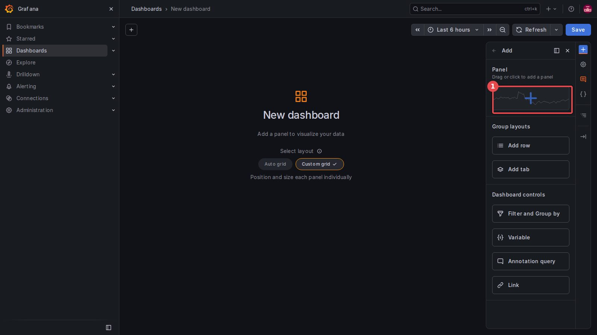
<sub>① 오른쪽 Add 창의 Panel 그림 클릭</sub>

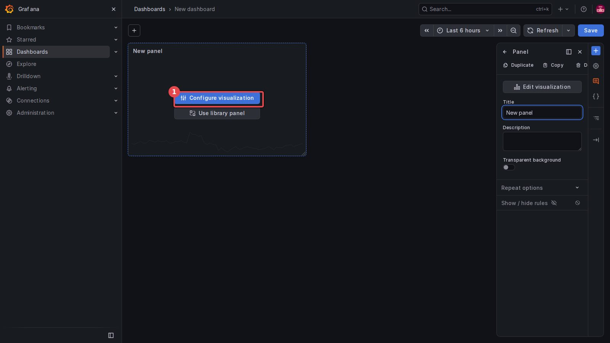
<sub>빈 패널이 생김 → ① Configure visualization</sub>

데이터 소스는 이미 **Prometheus**입니다. 쿼리 칸이 **Builder**(드롭다운) 모드라 붙여 넣기가 안 되므로 오른쪽 **Code**를 누릅니다.

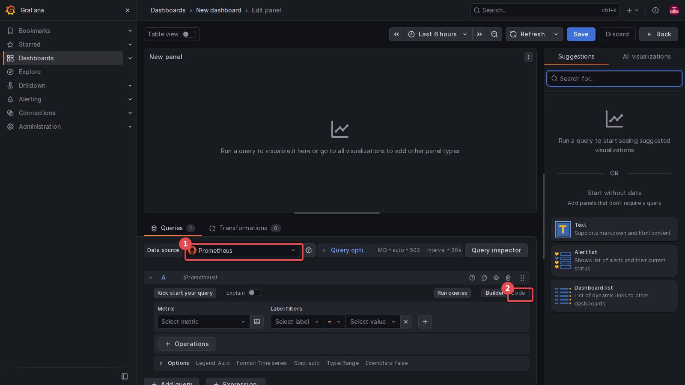
<sub>① 데이터 소스 Prometheus 확인 ② Code 클릭</sub>

```promql
sum by (route, code) (rate(todo_http_requests_total[1m]))
```

붙여 넣고 **Run queries** → 오른쪽 위 **All visualizations** 탭 → **Time series**.

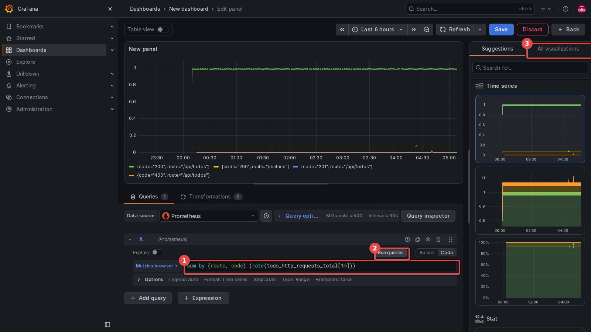
<sub>① 쿼리 ② Run queries ③ All visualizations → Time series</sub>

오른쪽 **Title**에 `요청 수`. 쿼리 아래 **Options**를 펼쳐 **Legend**를 **Custom**으로 바꾸면 입력 칸이 됩니다 → `{{route}} {{code}}`.

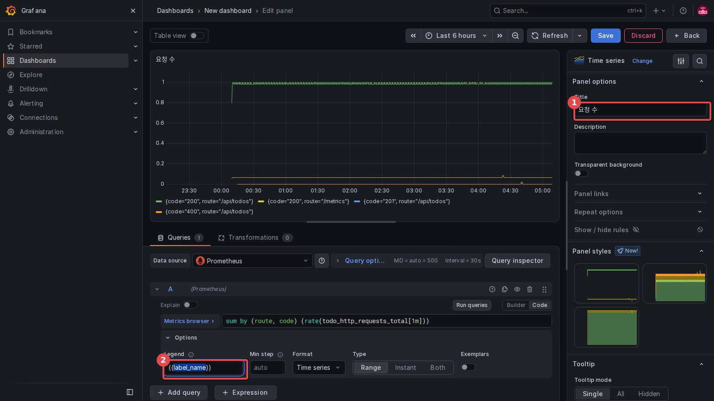
<sub>① Title ② Legend → Custom → {{route}} {{code}}</sub>

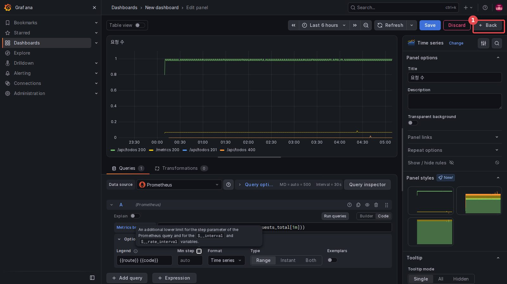
<sub>범례가 /api/todos 200 처럼 짧아짐 → ① Back</sub>

**이렇게 나오면 성공**: 선 4개 — `/api/todos 200`(약 1), `/metrics 200`(약 0.07), `/api/todos 201`·`400`(0).

여기서 한 번 저장해 두면 안전합니다. 오른쪽 위 **Save** → Title `todo-api` → **Save**.

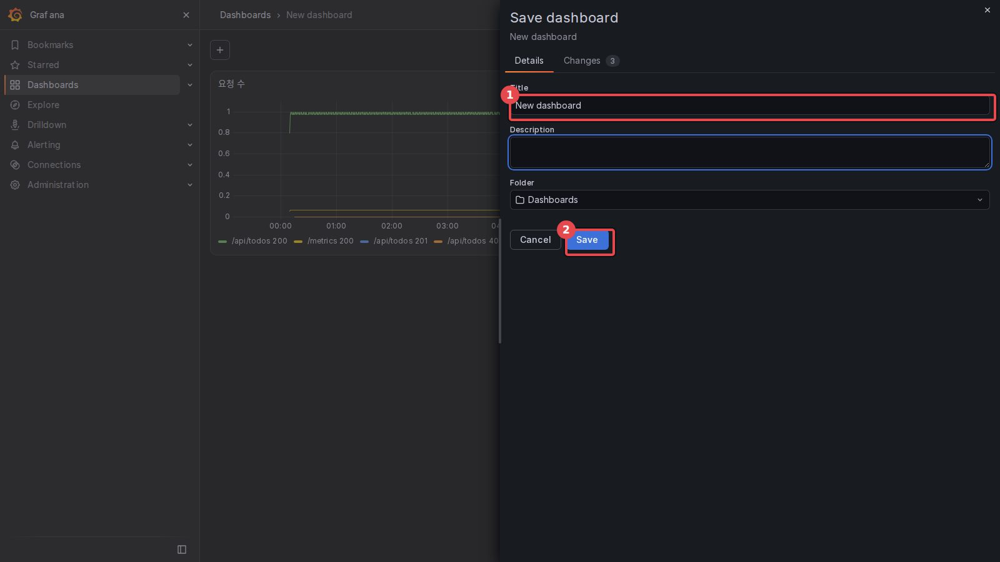
<sub>① 이름 todo-api ② Save</sub>

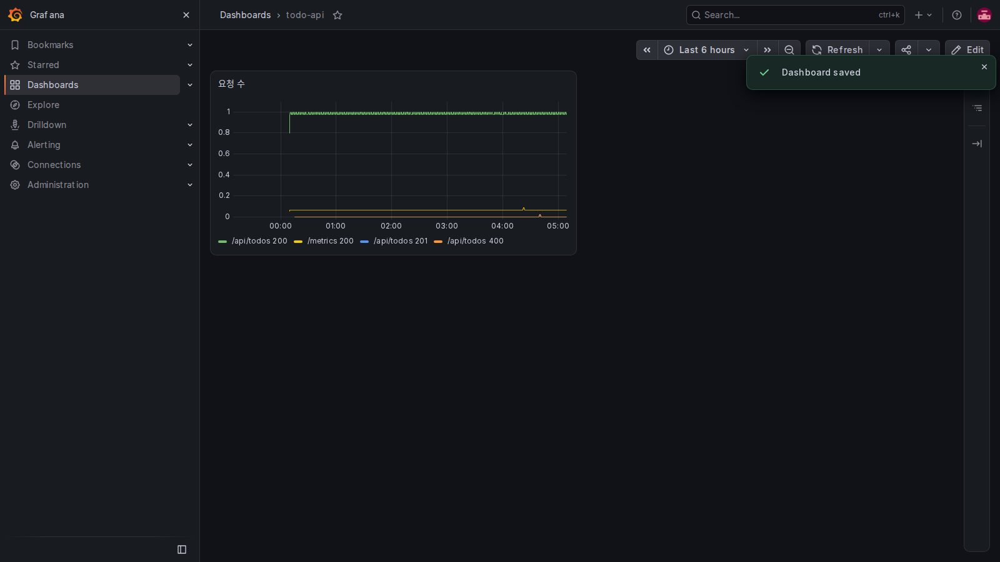
<sub>저장 완료 — 다시 고치려면 오른쪽 위 Edit</sub>

## 2단계. p95 패널

오른쪽 위 **Edit** → 왼쪽 위 **＋**(Add panel) → **Configure visualization** → Code에 붙여 넣기 → Run queries → Time series → Title `p95 처리 시간`.

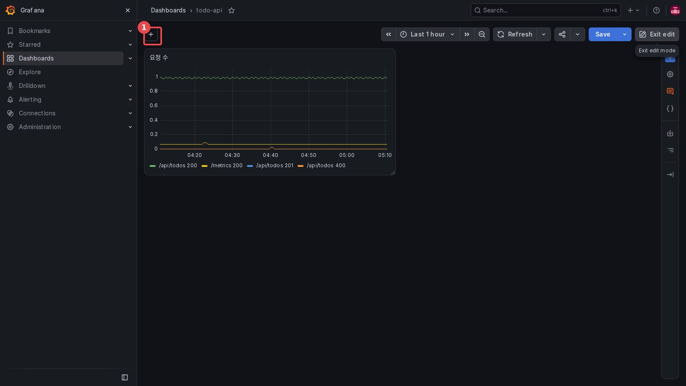
<sub>편집 모드 — ① ＋ 로 패널 추가</sub>

```promql
histogram_quantile(0.95, sum by (le) (rate(todo_http_request_duration_seconds_bucket{route="/api/todos"}[5m])))
```

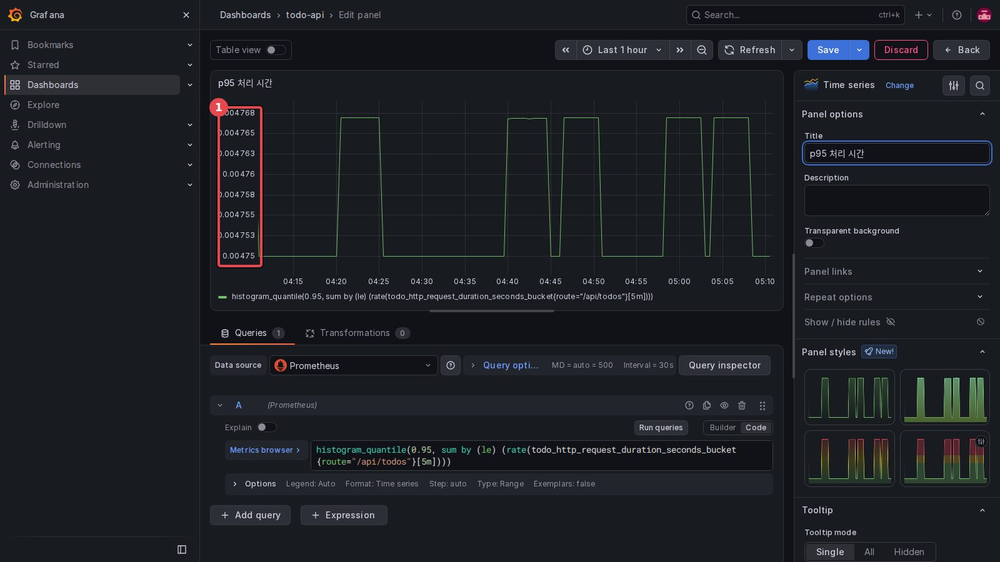
<sub>① 단위가 없어 0.004768 같은 숫자 → 초 단위로 바꿈</sub>

**Unit 찾기**: 오른쪽 옵션이 많으니 **돋보기(검색)** → `Unit` 입력 → **Choose** 칸에 `seconds`.

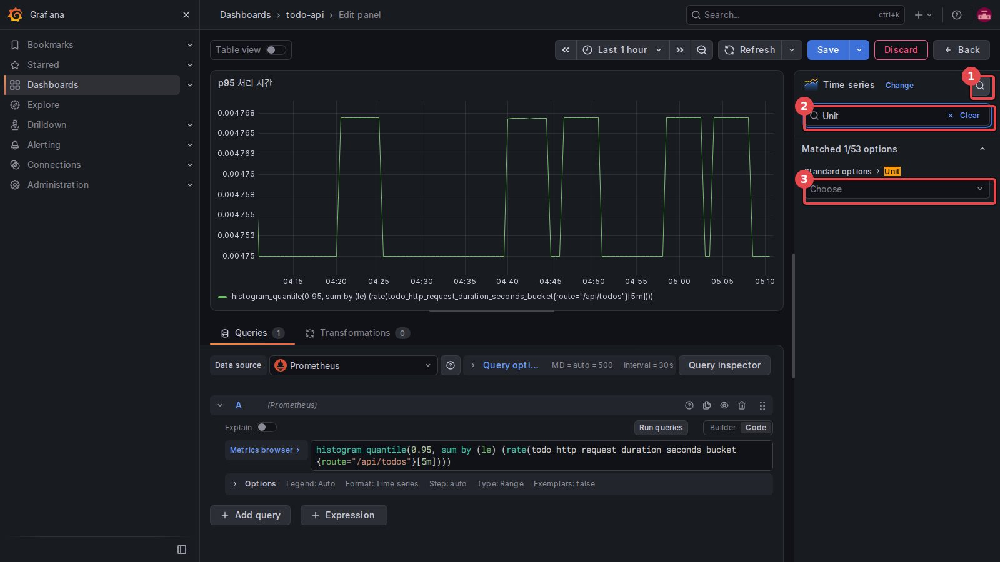
<sub>① 돋보기 ② Unit 검색 ③ Choose 클릭</sub>

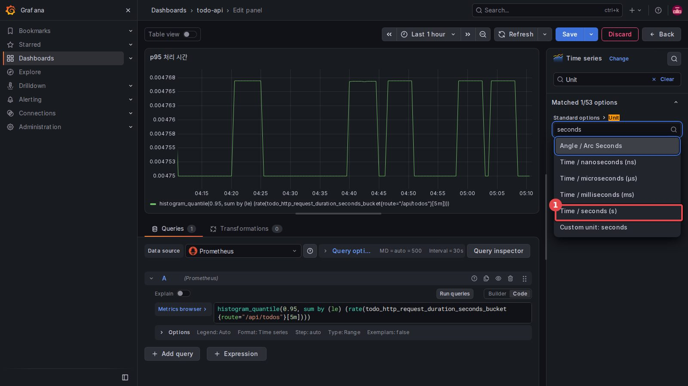
<sub>⚠ 맨 위 Angle / Arc Seconds가 골라져 있음 — Enter 금지. ① Time / seconds (s)를 직접 클릭</sub>

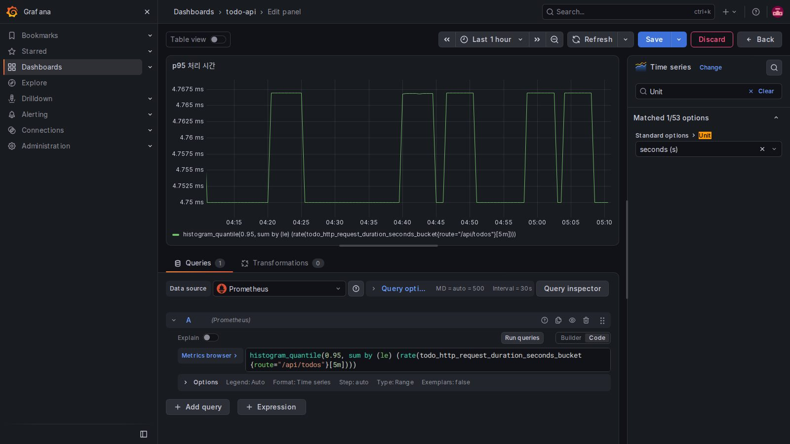
<sub>축이 4.765 ms 처럼 바뀜 → Back</sub>

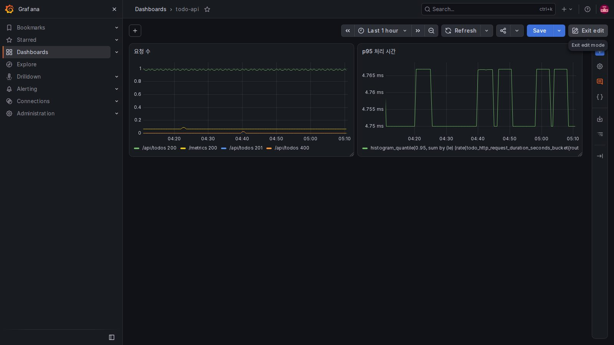
<sub>패널 2개 — p95 약 4.75~4.77 ms</sub>

## 3단계. 5xx 비율 — or vector(0) 없이 먼저

새 패널 → 종류 **Stat**(All visualizations의 "Big stat values"), Title `5xx 비율`, Unit 검색에 `Percent` → **Misc / Percent (0.0-1.0)**.

```promql
sum(rate(todo_http_requests_total{code=~"5.."}[1m])) / sum(rate(todo_http_requests_total[1m]))
```

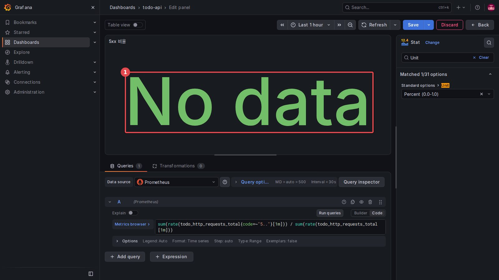
<sub>① 0%가 아니라 No data — 5xx가 한 번도 없어 분자가 "없음"</sub>

같은 칸의 쿼리를 아래로 바꾸고 Run queries.

```promql
(sum(rate(todo_http_requests_total{code=~"5.."}[1m])) or vector(0)) / sum(rate(todo_http_requests_total[1m]))
```

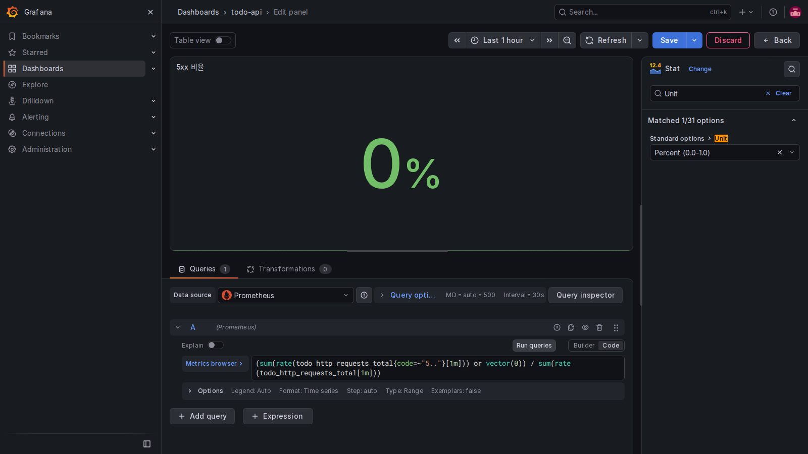
<sub>or vector(0) = "없으면 0으로" → 0%</sub>

**Thresholds**: 검색 칸에 `Thresholds` → 빨강 칸의 `80`을 `0.1`로 (10% 넘으면 빨강).

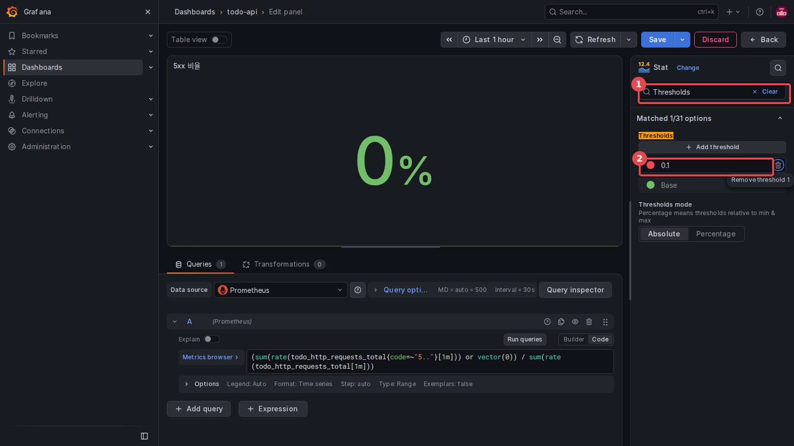
<sub>① Thresholds 검색 ② 80 → 0.1</sub>

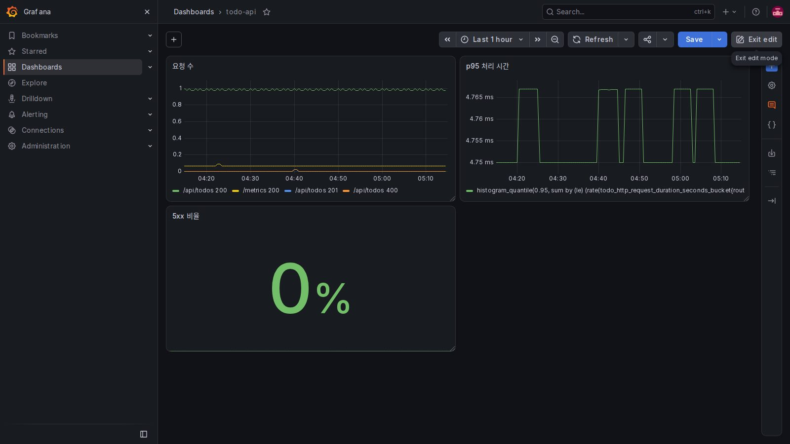
<sub>Back → Save. 패널 3개 완성</sub>

## 4단계. 장애 내고 패널 보기

오른쪽 위 Refresh 옆 드롭다운을 **10s**로 두고, VM 터미널에서:

```bash
kubectl -n todo scale deploy db --replicas=0
kubectl -n todo exec deploy/load -c curl -- curl -s -o /dev/null -w "%{http_code} %{time_total}s\n" http://web/api/todos
```

강사 VM 출력: `500 0.006774s` — 실패인데 **0.007초 만에** 돌아옵니다.

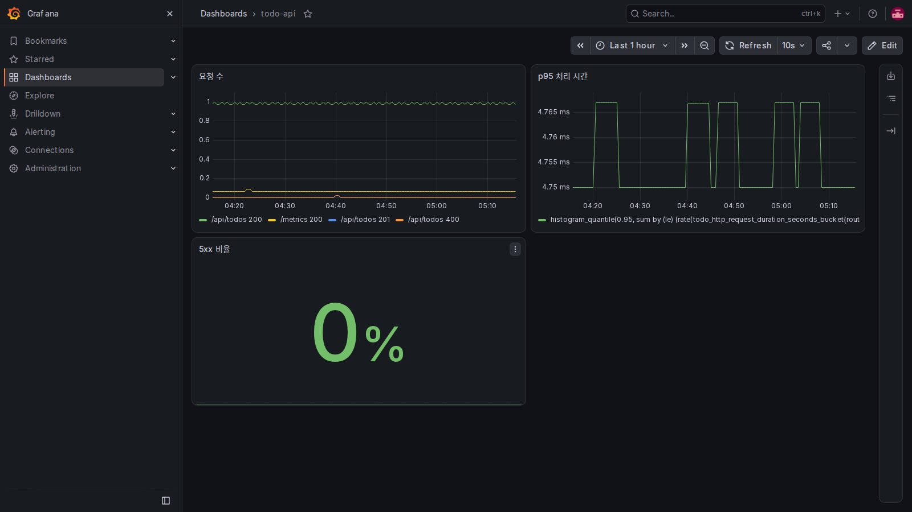
<sub>장애 전</sub>

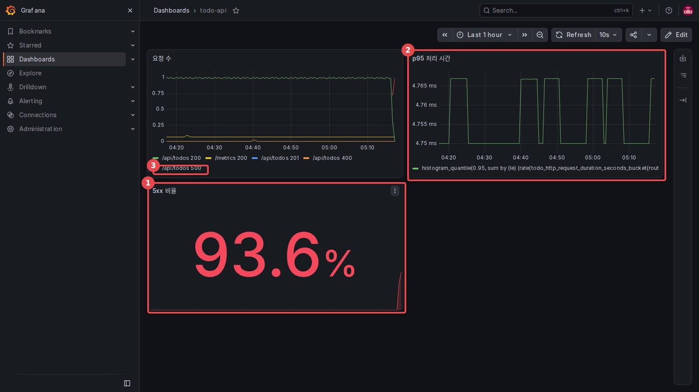
<sub>약 1분 30초 뒤 — ① 5xx 93.6% 빨강 ② p95는 그대로 약 4.7ms ③ /api/todos 500 선</sub>

> [!TIP]
> 장애인데 느려지지 않았습니다. api가 db에 붙자마자 끊겨 **바로** 500을 돌려주기 때문입니다. 처리 시간만 봤다면 놓칩니다 → 에러율 패널이 따로 필요합니다. 왜 500인지는 실습 6(로그)에서 찾습니다.

복구합니다.

```bash
kubectl -n todo scale deploy db --replicas=1
kubectl -n todo rollout status deploy/db
kubectl -n todo exec deploy/load -c curl -- curl -s http://web/api/todos; echo
```

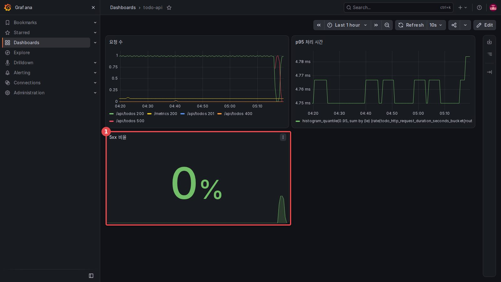
<sub>약 2분 뒤 ① 0% 초록으로 복귀 (그래프 끝에 빨간 구간이 남음)</sub>

## 5단계. 저장하고 JSON으로 내보내기

편집 중이면 **Save**. 그다음 오른쪽 세로 막대 맨 위 **내려받기 아이콘 → Export as code** → **Download file**.

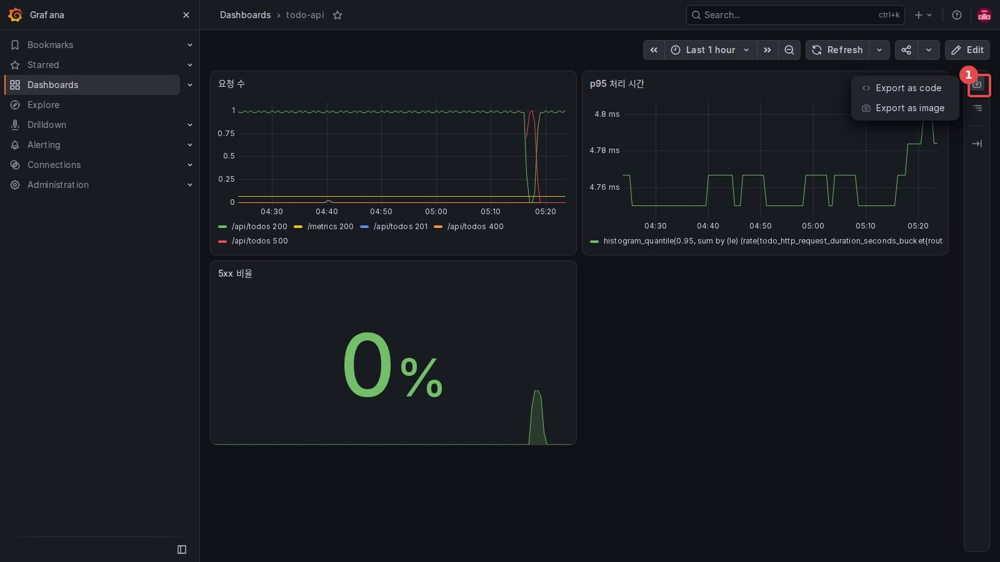
<sub>① 내려받기 아이콘 → Export as code</sub>

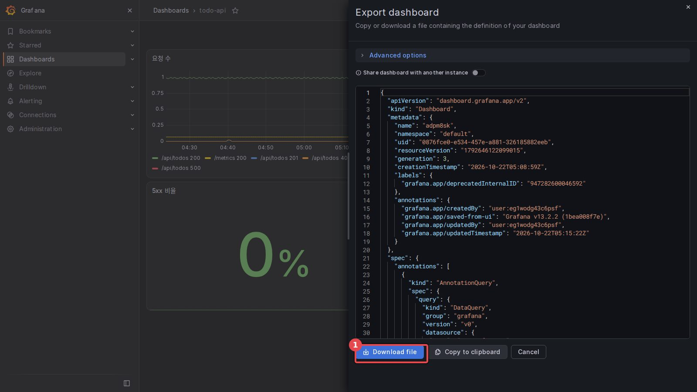
<sub>① Download file → 내 PC에 .json</sub>

이 JSON을 Git에 두면 누구나 **Dashboards → New → Import**로 같은 화면을 가져올 수 있습니다. 미션 1에서 씁니다.

---

[← 실습 5](./05-todo-대시보드-만들기.md) · [목차](../모니터링-실습.md)
