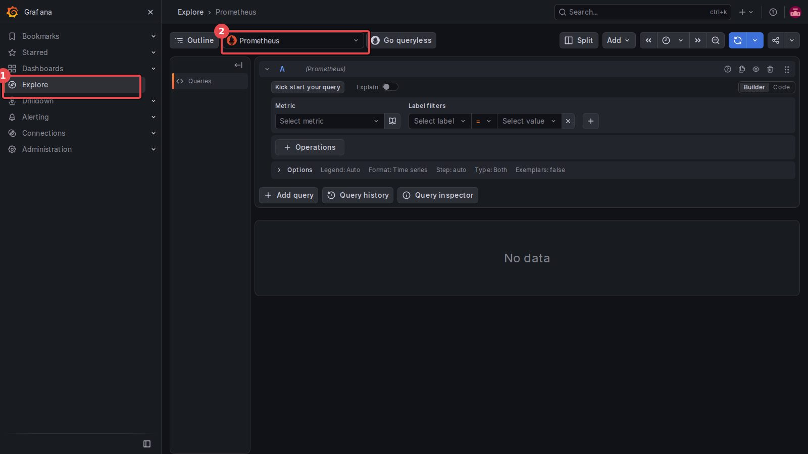
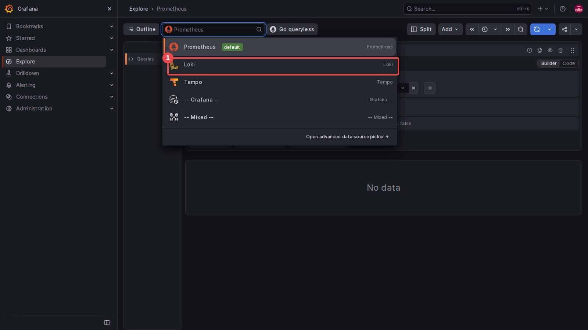
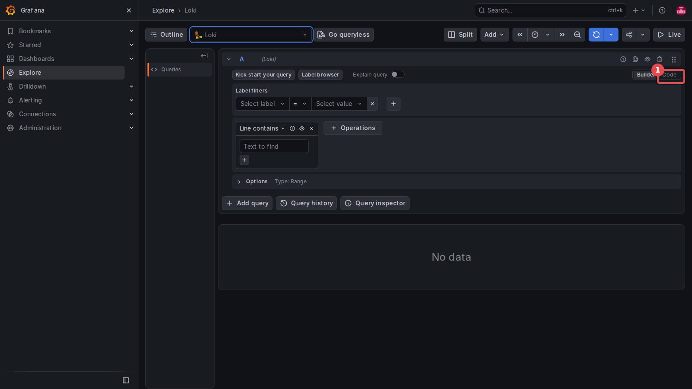
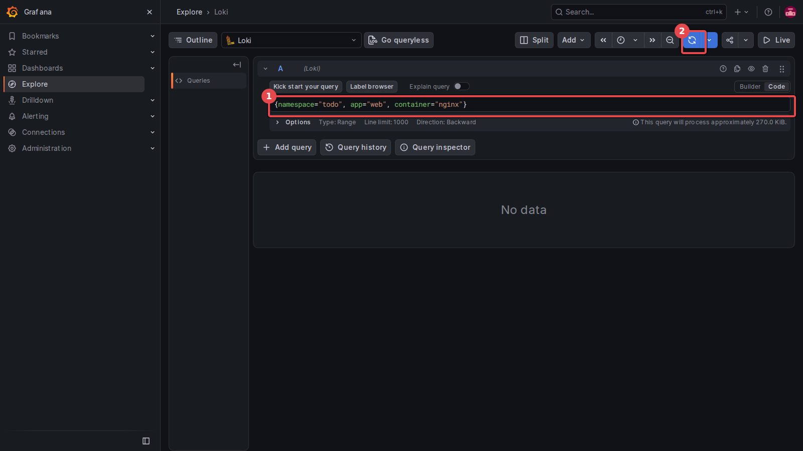
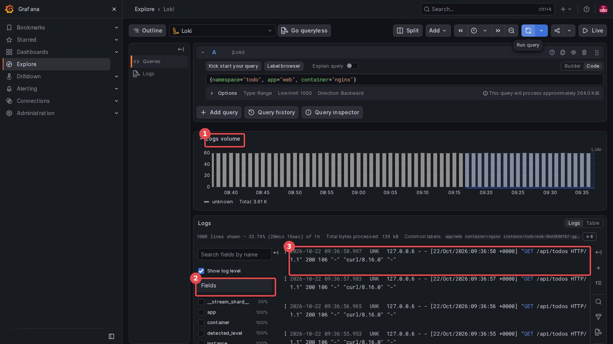
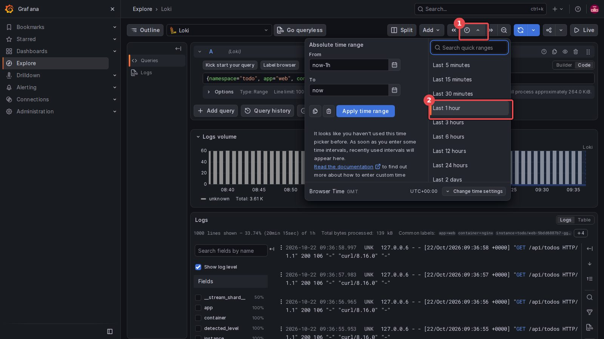
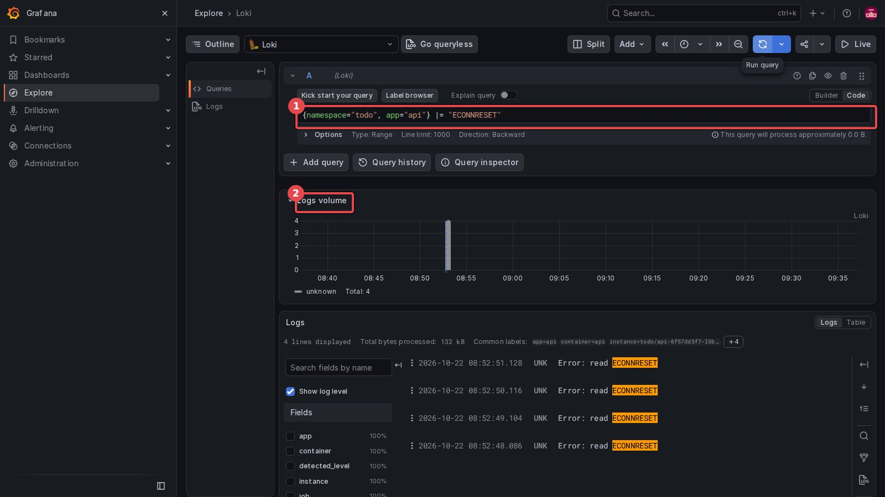
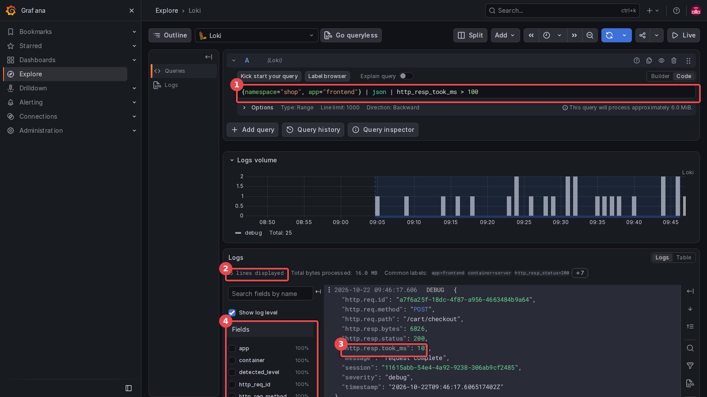
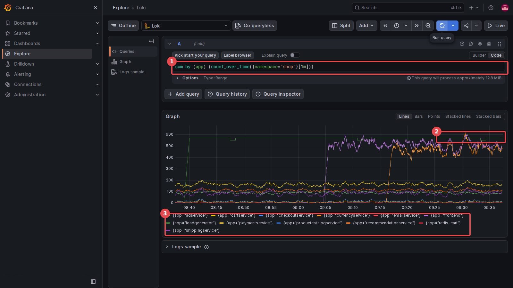
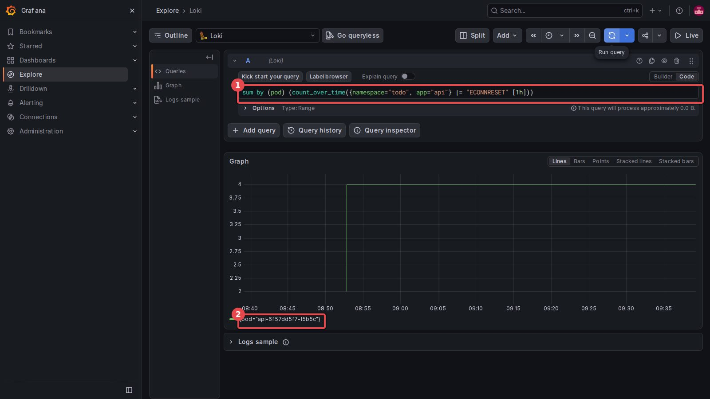

[← 실습 6](./06-Loki와-LogQL.md) · [목차](../모니터링-실습.md)

# 실습 6 화면 가이드 — Grafana Explore에서 로그 찾기

실습 6의 Grafana 부분(3~7단계)을 실제 화면(Grafana 13.2.2)으로 따라가는 그림 안내입니다. **빨간 네모의 숫자 = 보는 곳·누르는 순서**. 강사 VM에서 2026-10-22에 찍은 화면이라 줄 수·시각은 내 화면과 다를 수 있습니다.

> [!NOTE]
> **쿼리 하나 = 같은 순서 반복**: 쿼리 칸 클릭 → 전부 지우기(`Ctrl+A` → `Delete`) → 붙여 넣기 → 오른쪽 위 **파란 새로 고침 모양 버튼**(마우스를 올리면 `Run query`) 또는 `Shift+Enter`
>
> - Explore를 새로 열고 **첫 쿼리가 `No data`** 이면 Run query를 한 번 더 누르세요(강사 VM에서 두 번 겪음)
> - 대시보드를 만들 필요는 없습니다. 실습 6은 **Explore** 한 화면에서 쿼리만 바꿔 가며 봅니다

## 3단계. Explore 열고 Loki 고르기

왼쪽 메뉴 **Explore** → 위쪽 데이터 소스 칸(처음엔 `Prometheus`)을 누릅니다.


<sub>① Explore ② 데이터 소스 칸 클릭</sub>


<sub>① Loki 선택 (Prometheus = 숫자 지표, Loki = 로그, Tempo = 트레이스(실습 7))</sub>

쿼리 칸이 **Builder**(드롭다운) 모드라 붙여 넣기가 안 됩니다 → 오른쪽 **Code**.


<sub>① Code 클릭</sub>

```logql
{namespace="todo", app="web", container="nginx"}
```


<sub>① 쿼리 붙여 넣기 ② Run query (파란 새로 고침 모양)</sub>

**화면 읽는 법**


<sub>① Logs volume = 시간대별 로그 줄 수 막대 ② Fields = 이름표·필드 목록 ③ 로그 한 줄 = 요청 하나</sub>

- ① 막대 하나 = 그 시간대에 들어온 줄 수. 손님 `load`가 `curl` → `sleep 1`을 되풀이하니 1분에 약 60줄(curl 시간만큼 한 바퀴가 1초보다 조금 길어 59~60)로 고르게 나옵니다

- ② 왼쪽 **Fields**의 `app`·`container`·`namespace`·`pod`가 Alloy가 붙인 이름표입니다

- ③ `"GET /api/todos HTTP/1.1" 200 106` — 200이 응답 코드, 106이 응답 크기. 맨 앞 `UNK`는 로그 수준(level)을 모른다는 뜻이라 신경 쓰지 않아도 됩니다

## 4단계. 본문으로 거르기 — 실습 5의 500 찾기

오른쪽 위 시계 버튼에서 시간 범위가 **Last 1 hour**인지 확인합니다. 실습 5 장애가 1시간보다 전이면 **Last 3 hours**로.


<sub>① 시간 범위 버튼 ② Last 1 hour</sub>

```logql
{namespace="todo", app="web", container="nginx"} |= "\" 500 "
```


<sub>① `|=` = 이 글자가 들어 있는 줄만 ② 장애 시간대(08:52)에만 막대</sub>

web(nginx)이 `500 350`을 돌려준 줄만 남았습니다. 이제 쿼리를 api로 바꿉니다.

```logql
{namespace="todo", app="api"} |= "ECONNRESET"
```


<sub>① api의 db 연결 끊김 줄 ② web 500과 같은 시간대</sub>

**이렇게 나오면 성공**: 두 쿼리의 막대가 **같은 시각**에 있음. 강사 VM은 둘 다 4줄, 08:52:48 ~ 08:52:51 (문서의 129줄은 장애를 2분 둔 경우 — 장애를 둔 시간만큼 늘어남).

- 대시보드(실습 5)는 "500이 94%"까지, 로그는 **"api가 db 연결을 못 해서(`ECONNRESET`)"** 까지 말해 줍니다

## 5단계. JSON 필드로 거르기

```logql
{namespace="shop", app="frontend"} | json | http_resp_took_ms > 100
```


<sub>① 쿼리 ② 줄 수 ③ http.resp.took_ms 107 (100 넘음) ④ json이 풀어 준 필드 이름</sub>

- ③ 로그 원문 필드 이름은 `http.resp.took_ms`인데, `| json`이 풀면서 점을 `_`로 바꿔 `http_resp_took_ms`가 됩니다. 그래서 쿼리에는 밑줄 이름을 씁니다

- ④ 왼쪽 Fields에 `http_req_id`, `http_req_method`… 처럼 풀린 필드가 생깁니다 → 이 이름으로 거를 수 있습니다

- 줄 수는 쇼핑몰 부하에 따라 다릅니다(문서 2줄, 이 화면 25줄). 남은 줄이 모두 100ms 넘으면 성공

## 6단계. 로그 줄 수를 지표처럼

```logql
sum by (app) (count_over_time({namespace="shop"}[1m]))
```


<sub>① 쿼리 ② 위쪽 선 3개(약 470~570) ③ 앱마다 선 하나 (색 = 아래 범례)</sub>

- 결과가 숫자라 로그 목록 대신 **Graph**가 나옵니다

- 강사 VM 값(1분 줄 수): `loadgenerator` 571(맨 위 초록), `frontend` 476(보라), `currencyservice` 474(주황), 그 아래 cartservice 144 … emailservice 3

- loadgenerator(손님)가 요청을 보낼 때마다, frontend가 받을 때마다 한 줄씩 남겨 둘이 비슷합니다(확인 문제 1). 범례의 앱 이름을 누르면 그 선만 보입니다

- 중간에 선이 0에서 갑자기 올라가는 것은 그 앱의 로그가 Loki에 모이기 시작한 시점입니다

## 7단계. 파드를 지워도 로그가 남나

터미널에서 api 파드를 지웁니다. 강사 VM 결과:

```text
api-6f57dd5f7-l5b5c
pod "api-6f57dd5f7-l5b5c" deleted from todo namespace
deployment "api" successfully rolled out
error: error from server (NotFound): pods "api-6f57dd5f7-l5b5c" not found in namespace "todo"
```

`kubectl logs`는 `NotFound`입니다. 20초쯤 뒤 Explore에서:

```logql
sum by (pod) (count_over_time({namespace="todo", app="api"} |= "ECONNRESET" [1h]))
```


<sub>① 쿼리 ② 지운 파드 api-6f57dd5f7-l5b5c 의 선이 그대로 (4줄)</sub>

- 범례의 파드 이름이 위에서 지운 `OLD` 이름과 같으면 성공. 파드는 없지만 로그는 Loki에 남아 있습니다

- 새로 뜬 api 파드는 db 오류가 없어서 선이 생기지 않습니다

---

[← 실습 6](./06-Loki와-LogQL.md) · [목차](../모니터링-실습.md)
