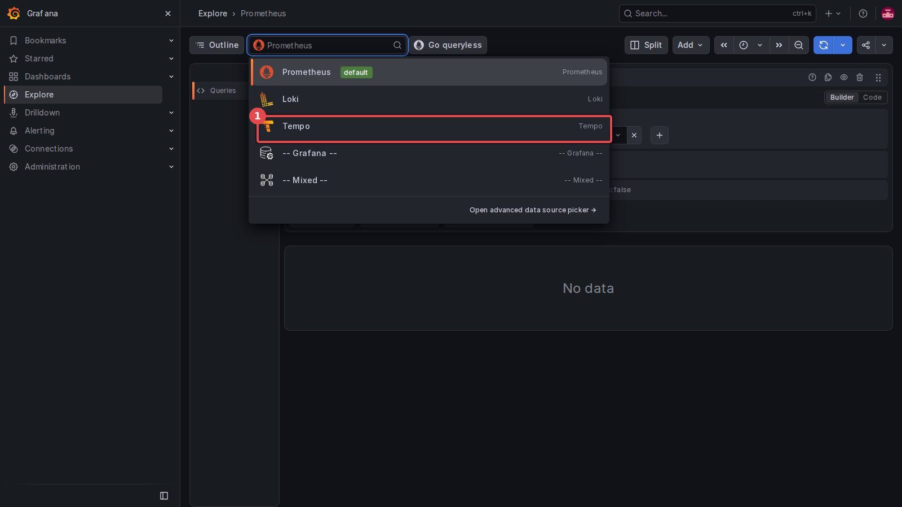
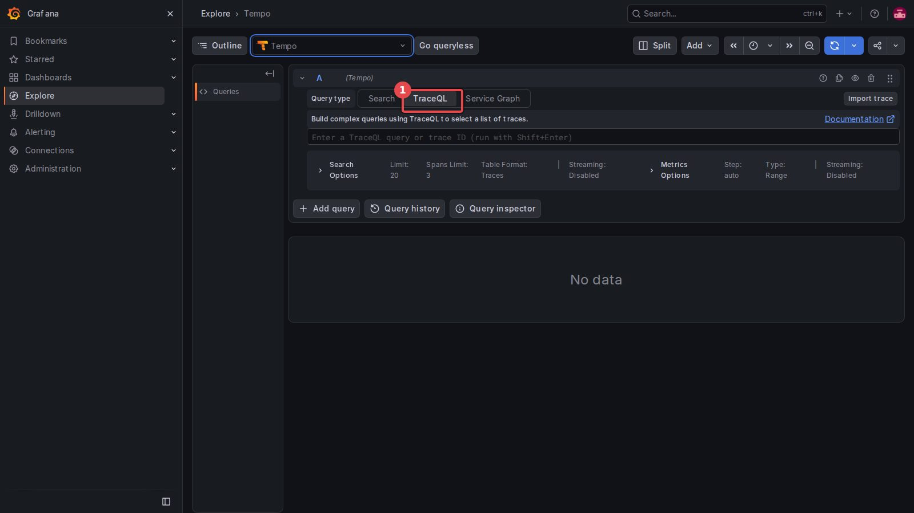
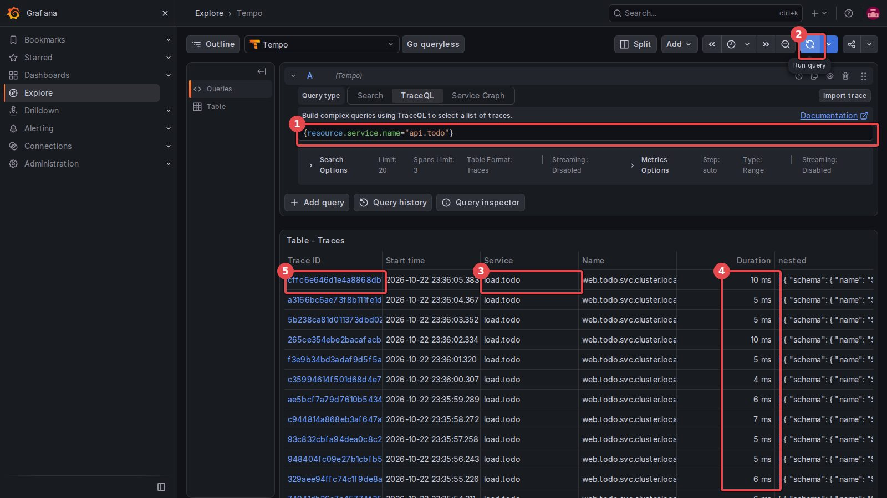
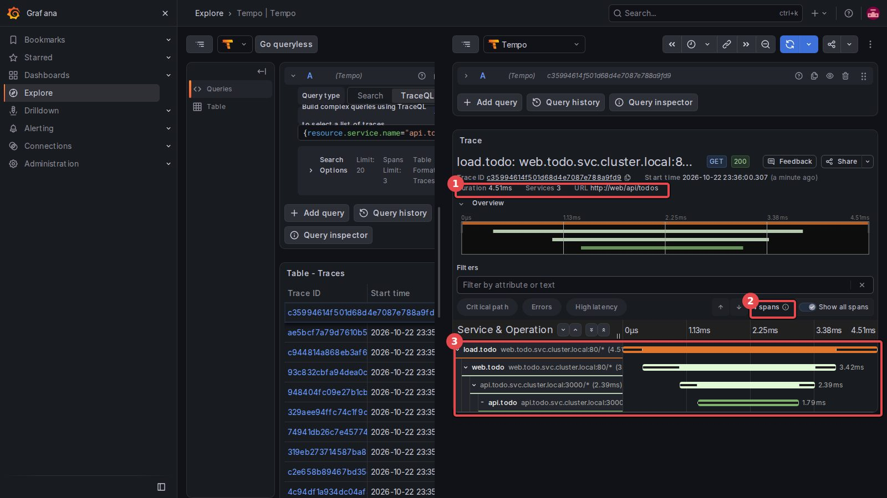
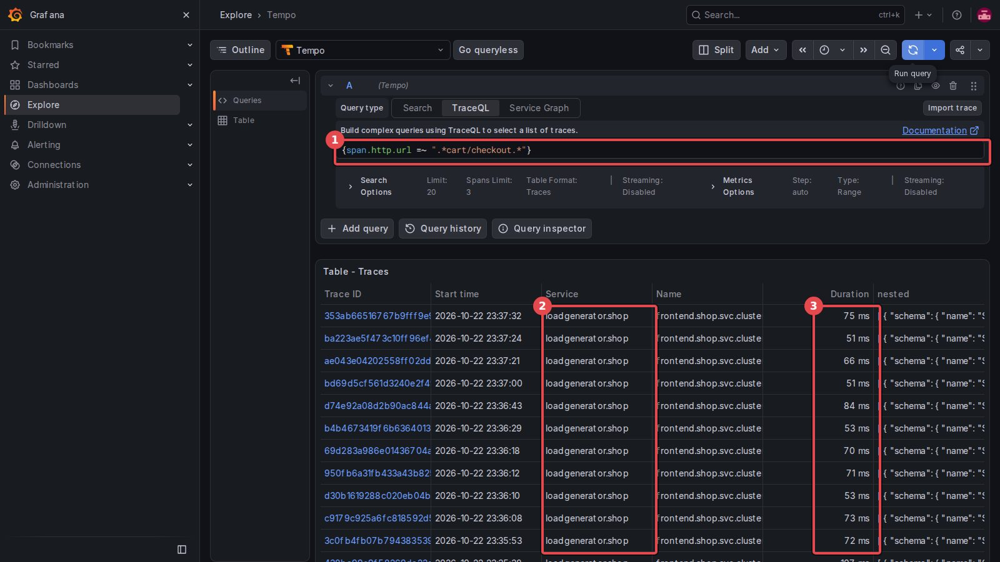
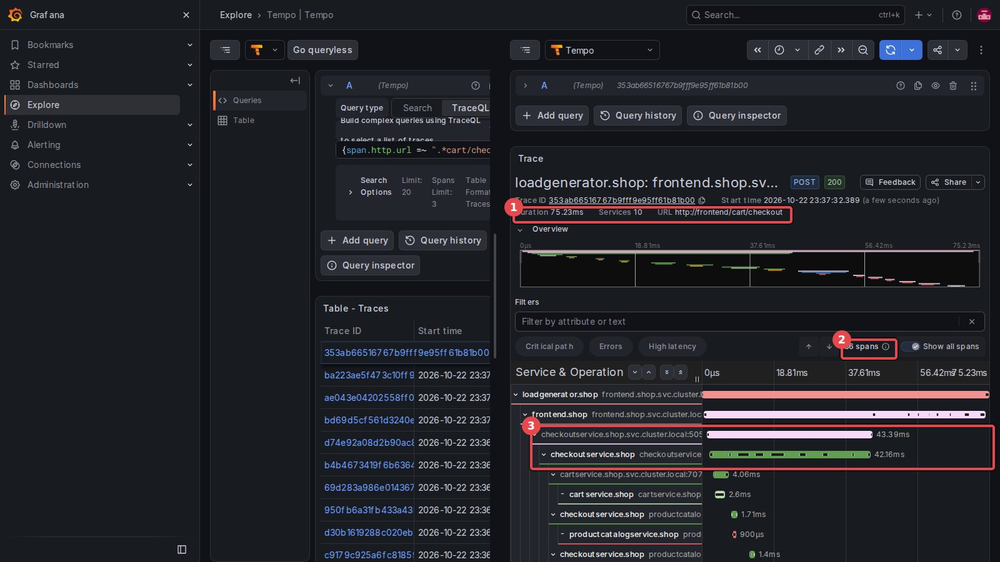
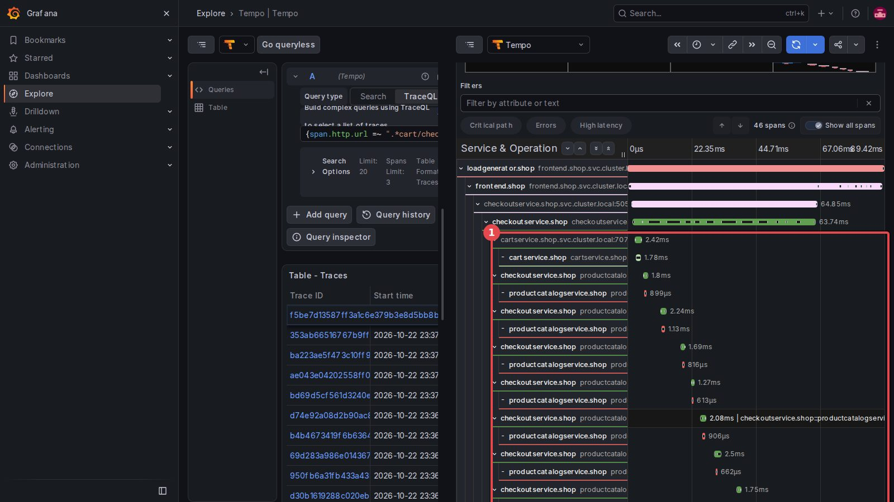
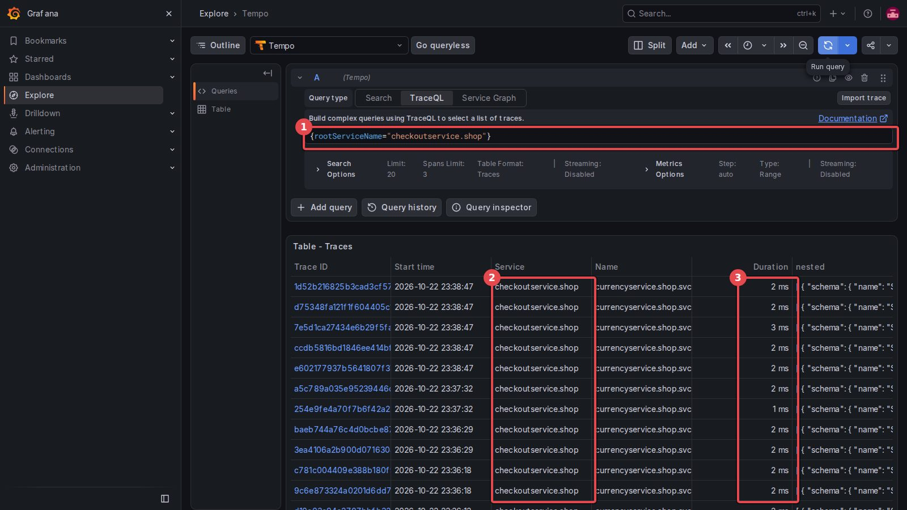
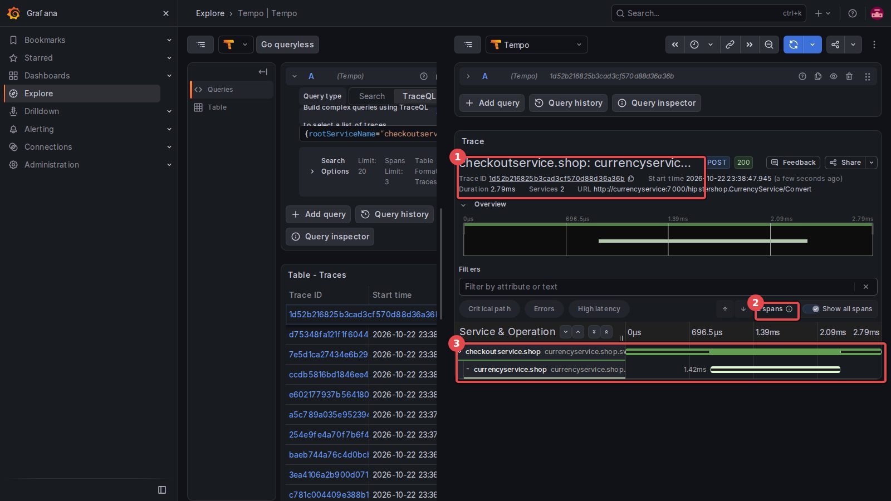

[← 실습 7](./07-한-요청이-지나간-길-Tempo.md) · [목차](../모니터링-실습.md)

# 실습 7 화면 가이드 — Grafana Explore에서 트레이스 읽기

실습 7의 Grafana 부분(5~7단계)을 실제 화면(Grafana 13.2.2)으로 따라가는 그림 안내입니다. **빨간 네모의 숫자 = 보는 곳·누르는 순서**. 강사 VM에서 2026-10-22에 2~4단계(`make tracing` → `istioctl install` → Telemetry)를 마치고 찍었습니다. ms 값은 요청마다 다릅니다.

> [!NOTE]
> **트레이스 하나 = 같은 순서 반복**: TraceQL 쿼리 → Run query → 표에서 **Trace ID(파란 글씨)** 클릭 → 오른쪽에 계단 화면
>
> - 트레이스를 열면 화면이 **좌우로 나뉩니다**(왼쪽 = 목록, 오른쪽 = 트레이스). 다른 쿼리를 넣으려면 왼쪽 쿼리 칸을 고치거나 오른쪽 창을 닫습니다
> - 첫 쿼리가 빈 목록이면 **Run query를 한 번 더**, 그래도 비면 4단계 뒤 1분 기다리기

## 5단계. todo 요청 하나 보기

**Explore** → 데이터 소스 칸 → **Tempo**.


<sub>① Tempo 선택 (Prometheus = 지표, Loki = 로그, Tempo = 트레이스)</sub>


<sub>① Query type을 TraceQL로 (기본은 Search)</sub>

```traceql
{resource.service.name="api.todo"}
```


<sub>① 쿼리 ② Run query ③ Service = 뿌리(시작) 서비스 load.todo ④ 걸린 시간 4~10ms ⑤ Trace ID를 누르면 열림</sub>

- 표 한 줄 = 손님 요청 하나. load가 1초에 한 번 부르니 1초마다 한 줄씩 생깁니다


<sub>① Duration 4.51ms · Services 3 ② 스팬 4개 ③ 계단 = 지나간 길</sub>

**계단 읽는 법** (위에서부터, 강사 VM 한 트레이스)

| 줄 | 뜻 | 시간 |
|---|---|---|
| `load.todo` → `web.todo…:80` | 손님 load의 사이드카가 **보낼 때** | 4.51ms |
| `web.todo` | web의 사이드카가 **받을 때** | 3.42ms |
| `api.todo.svc…:3000` | web의 사이드카가 api에 **보낼 때** | 2.39ms |
| `api.todo` | api의 사이드카가 **받을 때** | 1.79ms |

- 아래 막대는 위 막대 **안에** 들어 있습니다. api가 1.79ms 일하는 동안 web은 기다렸습니다

- db 줄은 없습니다. db는 PostgreSQL(HTTP 아님)이라 사이드카가 스팬을 만들지 않습니다

## 6단계. 쇼핑몰 주문 하나 읽기

왼쪽 쿼리 칸을 바꿉니다.

```traceql
{span.http.url =~ ".*cart/checkout.*"}
```


<sub>① 주문 쿼리 ② 뿌리 = loadgenerator.shop (쇼핑몰 손님) ③ 50~85ms</sub>


<sub>① 75.23ms · 서비스 10개 ② 스팬 36개 ③ frontend → checkoutservice PlaceOrder 43ms</sub>

계단 안쪽(오른쪽 창)을 아래로 굴리면 checkout이 부르는 서비스들이 나옵니다.


<sub>(다른 주문 트레이스) ① checkout 아래 cart → productcatalog → productcatalog … 막대가 오른쪽으로 한 칸씩 = **차례로** 부름</sub>

- 막대가 계단처럼 **오른쪽으로 밀려 나가는 것** = 앞 호출이 끝나야 다음 호출. 그 시간들이 더해져 checkout 전체 시간이 됩니다

- 1단계의 로그(합계 하나)와 지표(서비스별 p95)로는 볼 수 없던 것입니다

## 7단계. 이어지지 않은 트레이스

```traceql
{rootServiceName="checkoutservice.shop"}
```


<sub>① 쿼리 ② 뿌리가 checkoutservice ③ 1~3ms짜리</sub>


<sub>① checkoutservice → currencyservice Convert, 2.79ms ② 스팬 2개뿐 ③ 위에 loadgenerator·frontend가 없음</sub>

- 6단계 주문 트레이스에는 currency가 없었습니다. checkout 앱이 currency를 부를 때 **트레이스 번호를 넘기지 않아서** 사이드카가 새 트레이스를 시작했습니다

- 사이드카는 스팬을 만들 뿐이고, 번호를 다음 호출에 실어 보내는 것은 **앱 코드의 일**입니다

---

[← 실습 7](./07-한-요청이-지나간-길-Tempo.md) · [목차](../모니터링-실습.md)
