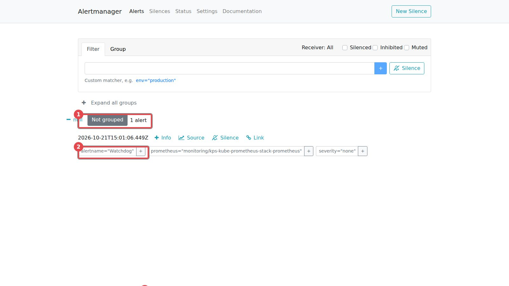
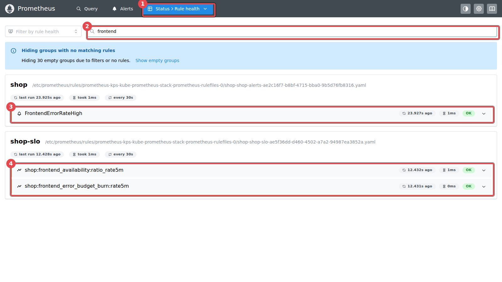
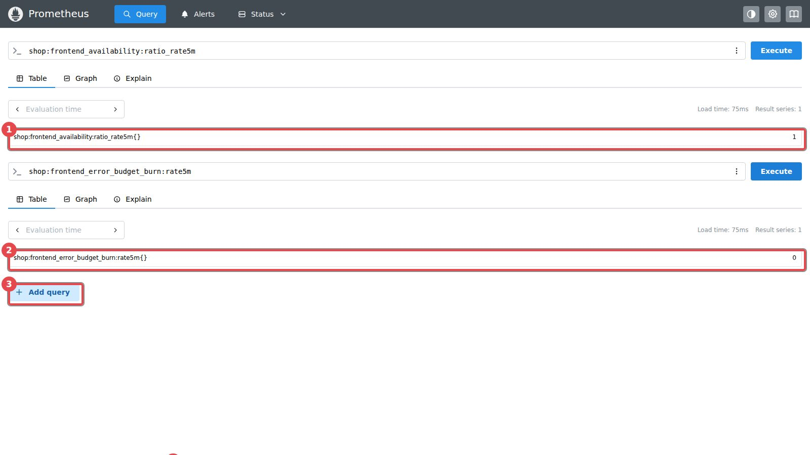
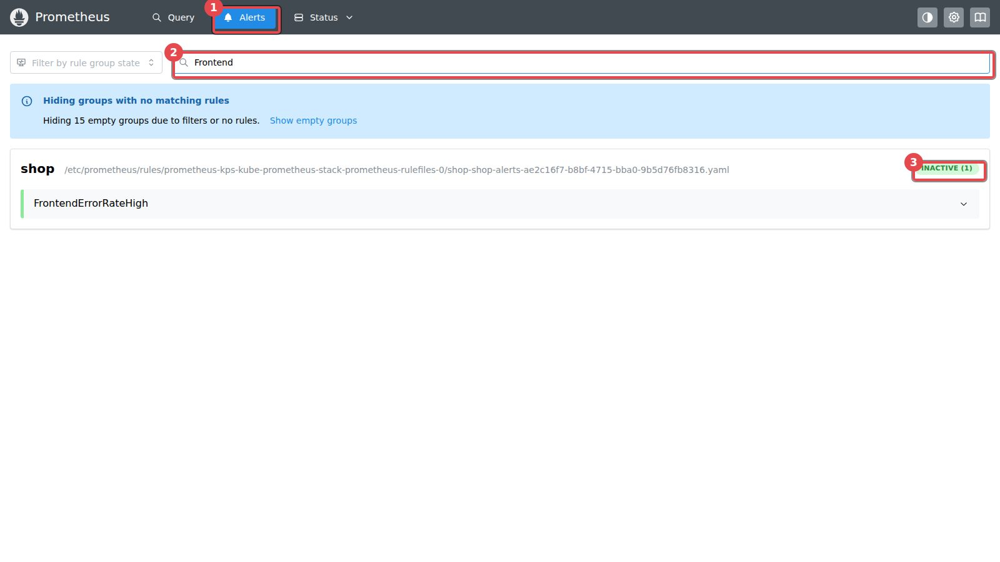
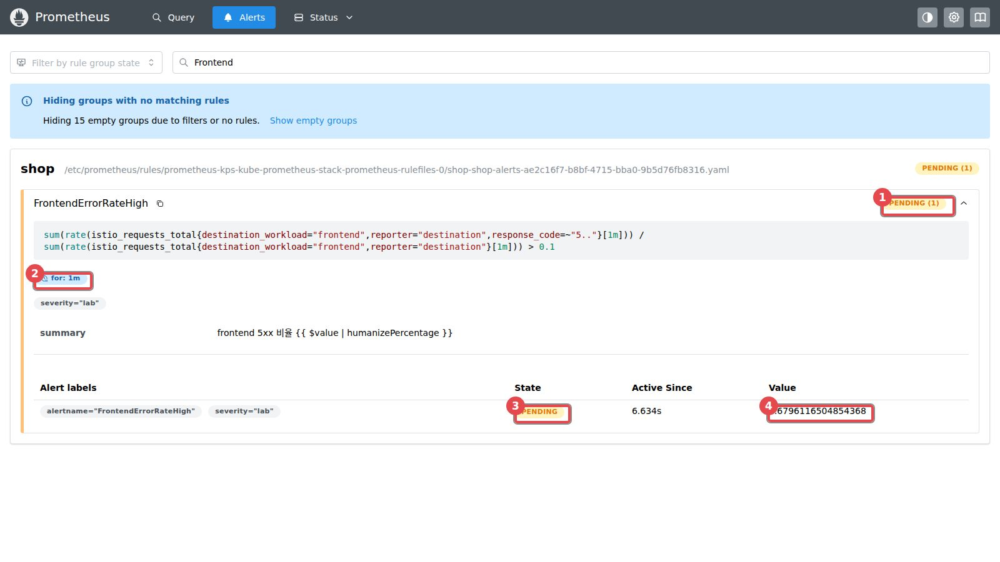
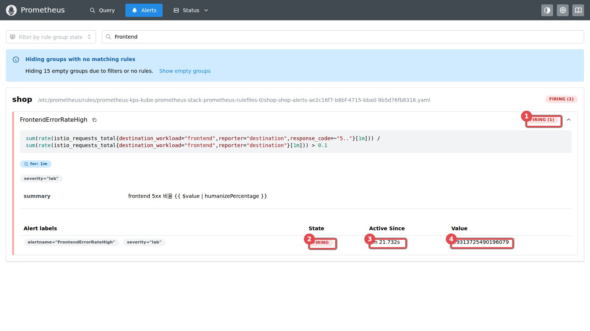
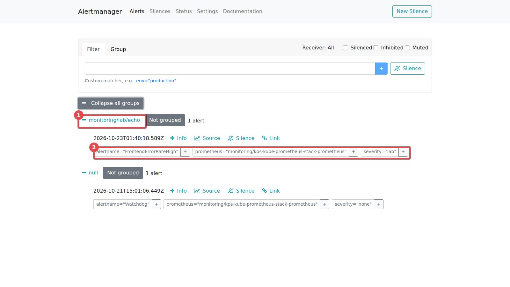
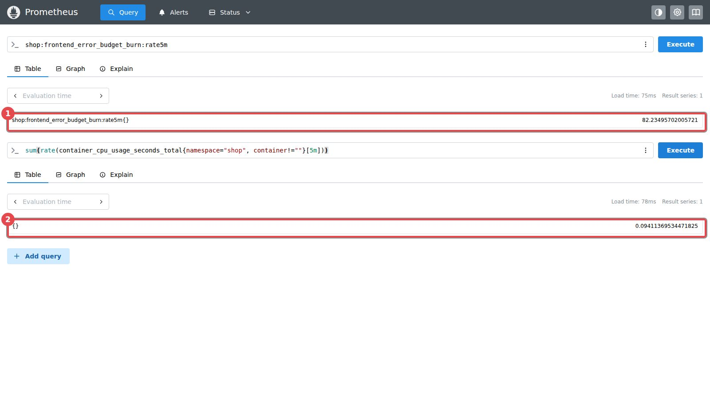
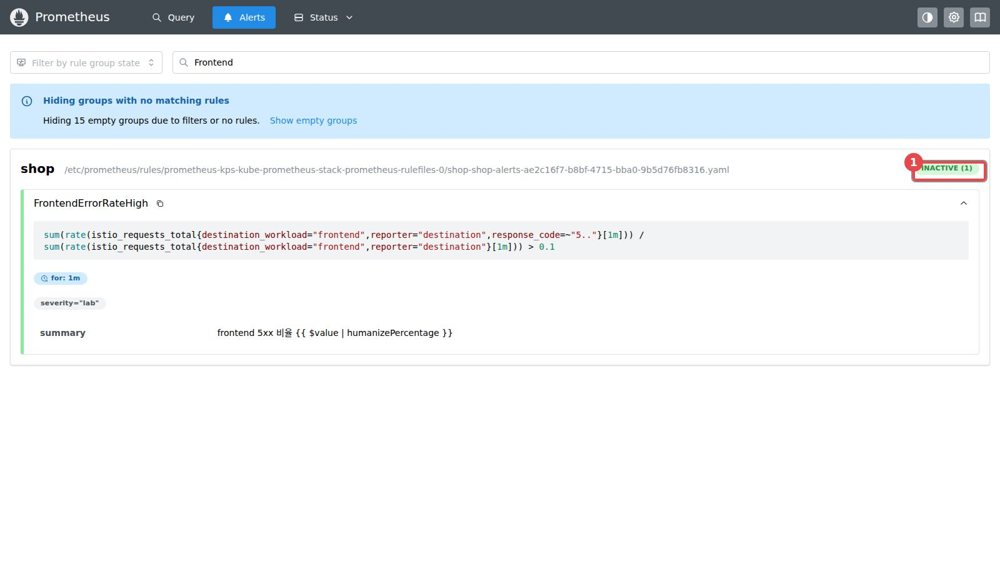

[← 실습 8](./08-경보와-SLO.md) · [목차](../모니터링-실습.md)

# 실습 8 화면 가이드 — 경보가 켜지고 도착하기까지

실습 8에서 **처음 보는 화면**(Prometheus Rule health·Alerts 탭, Alertmanager)만 모았습니다. 강사 VM에서 2026-10-23에 실습 8을 처음부터 끝까지 하며 찍었습니다. **빨간 네모의 숫자 = 보는 곳**. 시각·값은 내 화면과 다를 수 있습니다.

> [!NOTE]
> **주소 세 개**: Prometheus `prometheus.localhost` · Alertmanager `alertmanager.localhost` · Grafana `grafana.localhost`(6단계 로그 — [실습 6 화면 가이드](./06-화면-가이드.md)와 같은 Explore)
>
> Prometheus **Alerts**·**Rule health** 화면에는 기본 규칙이 수십 개 있어 내 규칙을 찾기 어렵습니다 → 위쪽 **Filter by rule name** 칸에 `Frontend`(또는 `frontend`)를 넣으면 내 것만 남습니다

## 1단계. 경보 규칙이 없을 때

Alertmanager(`alertmanager.localhost`) 첫 화면. 장애를 내도 여기에 오는 것은 이것 하나뿐입니다.


<sub>① 경보 1개 ② Watchdog — "경보 시스템이 살아 있다"는 신호로 항상 켜져 있는 경보</sub>

- 화재 감지기의 초록 불과 같습니다. Watchdog만 보인다 = 경보 시스템은 멀쩡한데 **장애를 잡을 규칙이 없다**

## 4단계. 규칙이 들어갔는지 — Rule health

`kubectl apply` 뒤 Prometheus 위쪽 **Status → Rule health** → 필터에 `frontend`.

```text
deployment.apps/alert-echo created
service/alert-echo created
prometheusrule.monitoring.coreos.com/shop-alerts created
alertmanagerconfig.monitoring.coreos.com/lab created
prometheusrule.monitoring.coreos.com/shop-slo created
Waiting for deployment "alert-echo" rollout to finish: 0 of 1 updated replicas are available...
deployment "alert-echo" successfully rolled out
```


<sub>① Status → Rule health ② frontend ③ 경보 규칙 FrontendErrorRateHigh ④ 기록 규칙 2개 — 모두 OK</sub>

- 종 모양 아이콘 = **경보 규칙**(조건이 맞으면 켜짐), 그래프 모양 아이콘 = **기록 규칙**(계산해서 새 지표로 저장)

- `every 30s` = 30초마다 검사. 그래서 장애를 내도 최대 30초는 늦게 알아챕니다

- 여기에 안 보이면: apply 직후(30초 뒤 다시) 또는 YAML 들여쓰기 깨짐

같은 쿼리 화면에서 **Add query**로 칸을 하나 더 만들어 평소 값을 봅니다.


<sub>① 가용성 1 (100% 성공) ② 소진 속도 0 ③ Add query = 칸 추가</sub>

위쪽 **Alerts** 탭 → 필터 `Frontend`.


<sub>① Alerts ② Frontend ③ INACTIVE(꺼짐, 초록)</sub>

## 5단계. 장애 → pending → firing

```bash
kubectl -n shop scale deploy productcatalogservice --replicas=0      # 장애 발생
```

Alerts 탭을 **몇 번 새로 고칩니다**(F5). 경보 이름을 누르면 아래가 펼쳐집니다.


<sub>장애 약 45초 뒤 — ① PENDING(노랑) ② for: 1m ③ 상태 ④ 지금 값 0.68 = 68%가 실패</sub>

- **pending** = 조건(10% 초과)은 맞았다, 1분 동안 계속 맞는지 **지켜보는 중**. 화재 감지기가 "진짜 불인가?" 확인하는 단계


<sub>장애 약 2분 뒤 — ① FIRING(빨강) ② 상태 ③ Active Since 1m 21s ④ 93% 실패</sub>

- **firing** = 1분 내내 맞았다 → Alertmanager로 넘김. 사이렌이 울린 단계

- 강사 VM: 45초에 pending, 2분 안에 firing (문서 51초 · 1분 53초)

**Alertmanager에 도착했나** — `alertmanager.localhost` → **Expand all groups**.


<sub>① 받는 곳 monitoring/lab/echo 묶음 ② FrontendErrorRateHigh, severity="lab"</sub>

- 1단계에는 null(Watchdog)만 있었는데 **echo 묶음이 새로 생겼습니다**. `severity="lab"` 이름표가 AlertmanagerConfig의 `matchers`와 맞아서 echo로 갑니다 → 이름표가 규칙과 보내는 길을 잇는 연결 고리

**소진 속도와 CPU** — Query에 칸 두 개(Add query).


<sub>장애 약 3분 뒤 — ① 소진 속도 82 (평소 0) ② shop 전체 CPU 0.094코어 (평소 약 0.13)</sub>

- 82 = 한 달 오류 예산을 **약 9시간**(30일 ÷ 82) 만에 다 쓰는 속도. 1분 더 지나자 125까지 오름(5분 창이 장애로 채워지는 중)

- 그런데 CPU는 **줄었습니다** → CPU로 경보를 걸었다면 이 장애를 못 잡음

## 6단계. 받는 곳 도착

```bash
kubectl -n monitoring logs deploy/alert-echo | grep -o '"alertname": "[A-Za-z]*"' | sort | uniq -c
```

```text
      2 "alertname": "FrontendErrorRateHigh"
```

- echo 서버(회사라면 Slack·메일 자리)가 경보를 **받았습니다**. 2인 이유: 알림 한 번에 이름이 두 번 들어 있음

- 장애 로그(왜 500인가)는 Grafana Explore(Loki)에서 — [실습 6 화면 가이드](./06-화면-가이드.md)와 같은 화면에 쿼리만 바꿈

## 7단계. 복구와 해제

```bash
kubectl -n shop scale deploy productcatalogservice --replicas=1      # 복구
kubectl -n shop rollout status deploy/productcatalogservice
```


<sub>복구 약 2분 뒤 — ① 다시 INACTIVE(초록)</sub>

```bash
kubectl -n monitoring logs deploy/alert-echo | grep -o '"status": "[a-z]*"' | sort | uniq -c
```

```text
      2 "status": "firing"
      2 "status": "resolved"
```

- `sendResolved: true`라 **"해결됨"** 알림도 옴. 회사에서는 이것을 보고 "누가 고쳤구나"를 압니다

- 경보는 2분 안에 꺼지지만 소진 속도는 5분 창이 다 지나야 0 근처로 돌아옵니다(약 6분)

## 한눈에 — 강사 VM 시간표

| 장애 뒤 | Prometheus Alerts | 값 | Alertmanager |
|---|---|---|---|
| 0초 | INACTIVE | | Watchdog만 |
| 약 45초 | **PENDING** | 5xx 68% | |
| 2분 안 | **FIRING** | 5xx 93% | echo 묶음 생김, echo 로그에 도착 |
| 3분 | FIRING | 소진 속도 82, CPU 0.094 | |
| 복구 1분 | FIRING | | |
| 복구 2분 | **INACTIVE** | | echo 로그에 resolved |

---

[← 실습 8](./08-경보와-SLO.md) · [목차](../모니터링-실습.md)
