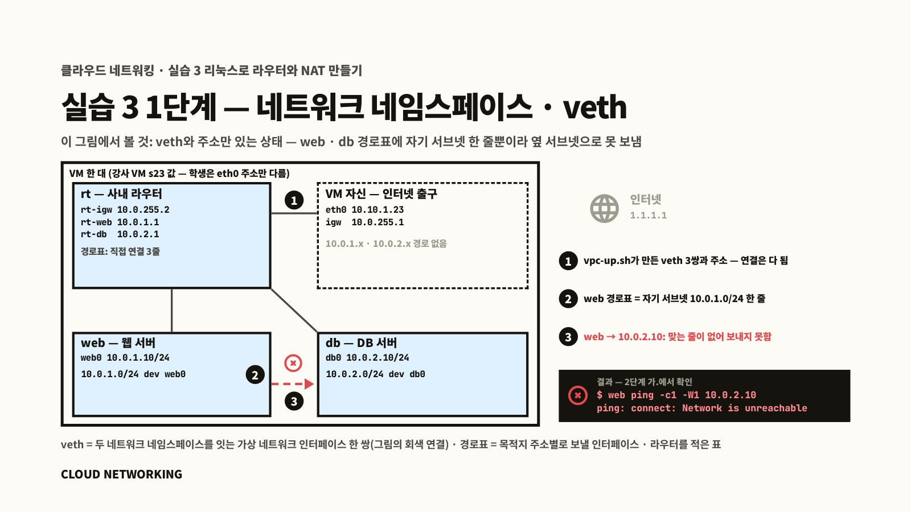
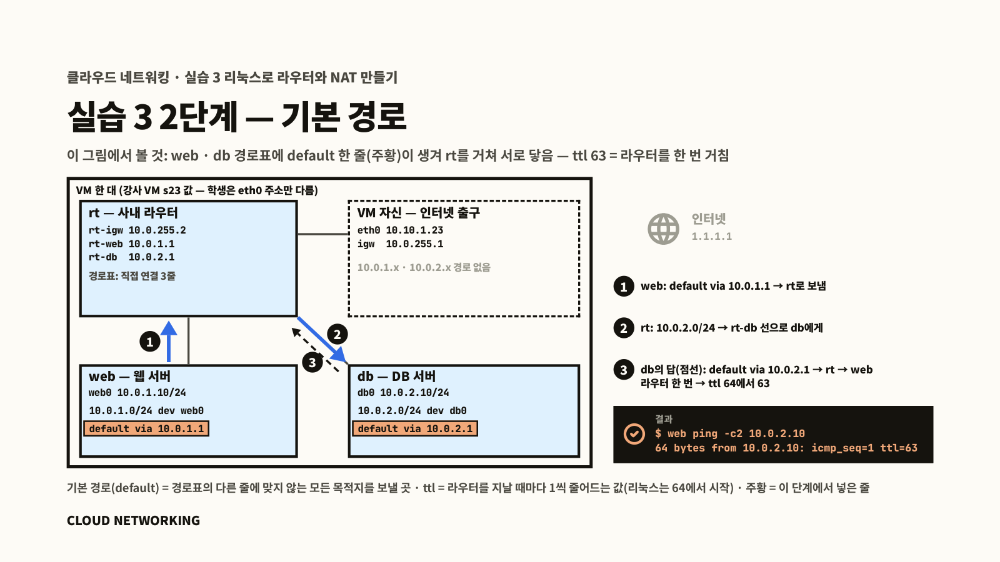
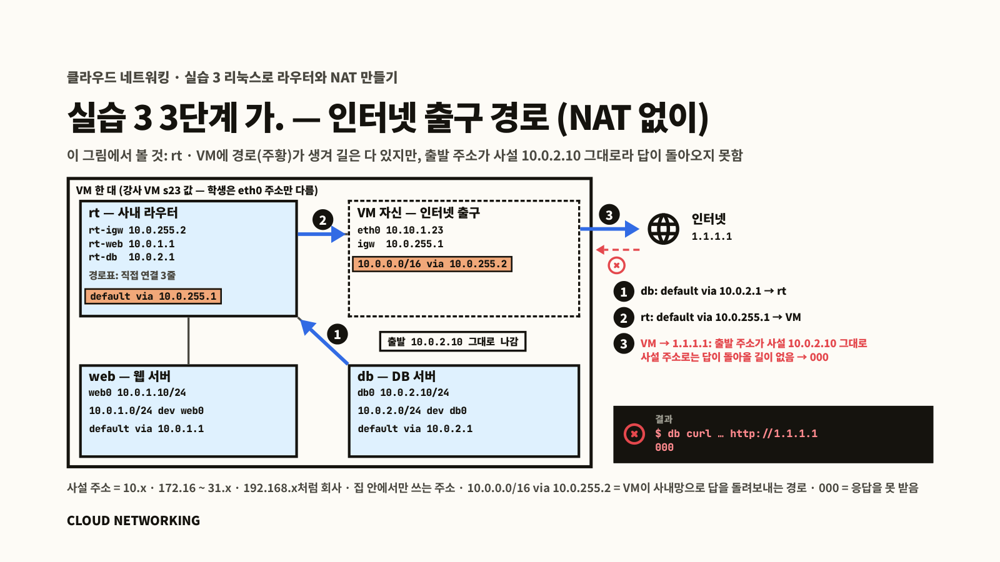
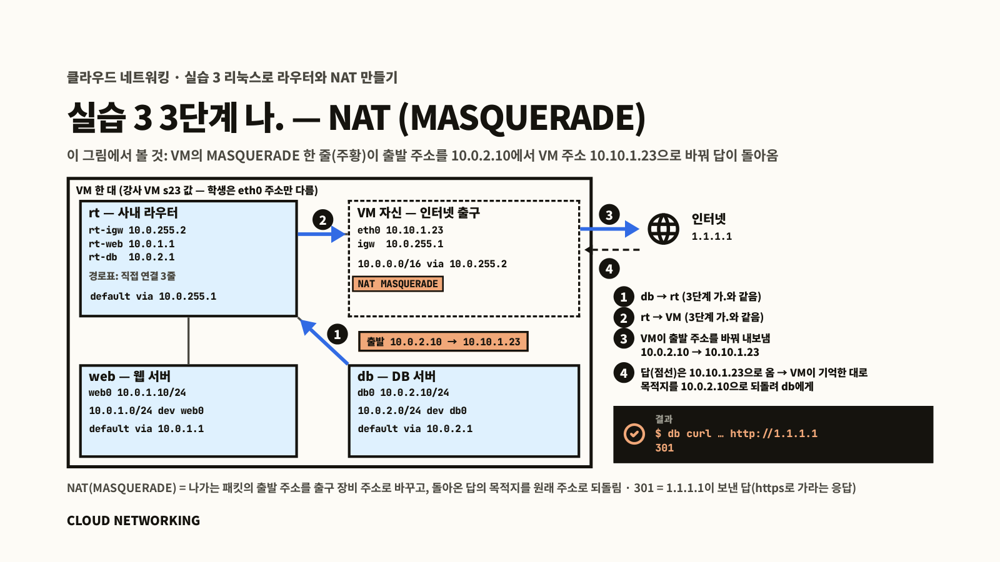
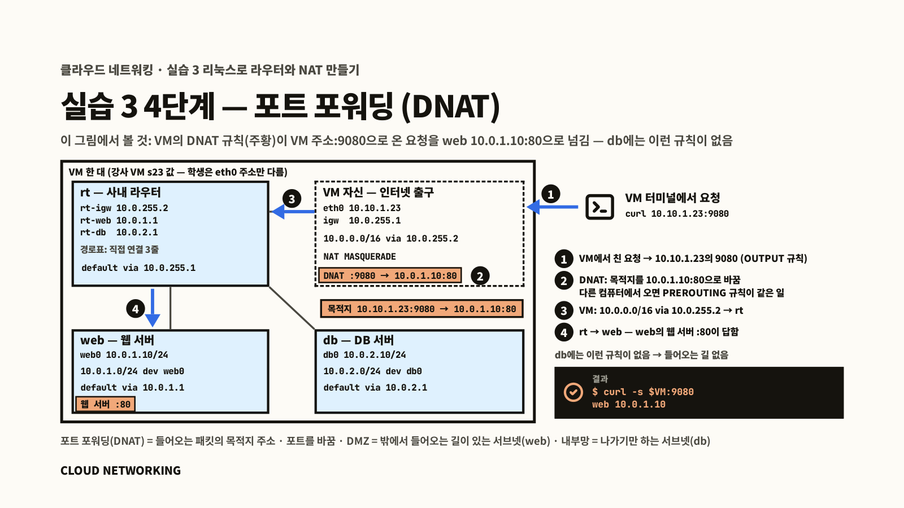

[← 실습 2](./02-VM의-IP-주소와-경로-확인.md) · [목차](../클라우드-네트워킹-실습.md) · [실습 4 →](./04-서버-방화벽.md)

# 실습 3. 리눅스로 라우터와 NAT 만들기

**무엇을 하나요**: VM 안에 **네트워크 네임스페이스**로 작은 사내망(`10.0.0.0/16` 대역)을 만듭니다. 사내 라우터 `rt`, 웹 서브넷(DMZ — 바깥에 여는 망)의 `web`(`10.0.1.10`), DB 서브넷(내부망 — 바깥에 열지 않는 망)의 `db`(`10.0.2.10`)입니다. VM 자신은 회사의 인터넷 출구(공유기·방화벽 장비 자리)를 맡습니다. 리눅스 명령으로 라우터를 만드는 것은 흉내가 아닙니다. 회사에서 리눅스 서버를 라우터로 쓸 때 하는 일과 같은 일입니다. 길(경로)이 없으면 옆 서브넷에도 못 가는 것, NAT가 없으면 인터넷에서 답이 돌아오지 않는 것을 먼저 겪고, 기본 경로 · NAT · 포트 포워딩을 한 줄씩 넣습니다. 실습 2의 "`default via 10.10.0.1`"과 서버가 VM에게 해 주던 NAT를 직접 만드는 실습입니다. (교안 03장)

**필요한 것**: 실습 2. 학생 저장소 `~/ktcloud-cloud-native-lab`(Docker 과목에서 받음). 쿠버네티스 클러스터는 건드리지 않습니다.

> **바로 가기** · [네트워크 네임스페이스 · veth · 줄임말](#네트워크-네임스페이스--veth--줄임말) · [1. 빈 사내망 만들기 — 라우터와 서버 두 대](#1단계-빈-사내망-만들기--라우터와-서버-두-대) · [2. 기본 경로 설정 — 사내 라우터로](#2단계-기본-경로-설정--사내-라우터로) · [3. 인터넷 출구 경로와 NAT](#3단계-인터넷-출구-경로와-nat) · [4. 밖에서 web으로 — 포트 포워딩](#4단계-밖에서-web으로--포트-포워딩) · [끝났는지 확인](#끝났는지-확인) · [정리](#정리) · [확인 문제](#확인-문제)

## 네트워크 네임스페이스 · veth · 줄임말

1단계 전에 이 실습에 계속 나오는 이름을 봅니다. 교안 03장 "그림으로 보는 네트워크 네임스페이스" 슬라이드가 같은 내용을 그림으로 보여 줍니다.

- **네트워크 네임스페이스**는 리눅스가 주소 · 네트워크 인터페이스 · 경로표 · 방화벽 규칙을 따로 갖게 나눈 공간입니다. 이 실습에서는 `rt` · `web` · `db` 세 네임스페이스를 각각 서버 한 대로 씁니다. VM은 한 대 그대로입니다.
- **veth**는 두 네임스페이스를 잇는 가상 네트워크 인터페이스 한 쌍입니다. 한쪽 끝으로 보낸 패킷이 다른 쪽 끝으로 나옵니다. 예를 들어 `rt`의 `rt-web`과 `web`의 `web0`이 한 쌍입니다.
- `sudo ip netns exec web 명령`은 web 안에서 그 명령을 실행합니다. 1단계 셋째 줄에서 만드는 줄임말 `web 명령`이 같은 뜻입니다(`db`, `rt`도 같습니다).
- `sudo ip -n web route …`는 web의 경로표를 바꿉니다(2단계).
- 네임스페이스 셋, veth 세 쌍, 주소는 1단계의 `vpc-up.sh`가 만들어 줍니다. 경로는 넣지 않습니다.

## 1단계. 빈 사내망 만들기 — 라우터와 서버 두 대

```bash
cd ~/ktcloud-cloud-native-lab && git pull && cd lab/network
sudo bash vpc-up.sh
alias web="sudo ip netns exec web" db="sudo ip netns exec db" rt="sudo ip netns exec rt"
web ip -br addr
web ip route
```

**이 명령은**: `vpc-up.sh` = 네임스페이스 `rt`(사내 라우터) · `web` · `db`를 만들고 선(veth)과 주소까지만 붙임. **길(경로)은 아직 없음**. 셋째 줄 = 줄임말([시작하기 전에 2](./00-시작하기-전에.md#2-줄임말-web--db--rt--새-터미널마다-다시)) — `web 명령` = "네임스페이스 web 안에서 명령". 4·5줄 = web의 주소와 경로표.

**이렇게 나오면 성공**

```
빈 VPC 준비 완료:
db (id: 5)
web (id: 2)
rt (id: 1)
lo               UNKNOWN        127.0.0.1/8 ::1/128
web0@if83        UP             10.0.1.10/24 fe80::388b:c5ff:fe3d:19fb/64
10.0.1.0/24 dev web0 proto kernel scope link src 10.0.1.10
```

- web은 `10.0.1.10`, 경로표에는 **자기 칸 한 줄**뿐입니다. 실습 2에서 본 VM의 표에서 `default` 줄이 빠진 모양입니다
- `(id: N)`·`@if83`의 숫자는 사람마다 다릅니다
- 스크립트 이름과 출력의 `VPC`는 이 실습의 사내망을 가리킵니다



<details><summary><b>이렇게 나오면?</b> — 자주 나는 오류와 해결 (눌러서 펼치기)</summary>

| 화면 | 원인 | 해결 |
|---|---|---|
| `bash: vpc-up.sh: No such file or directory` | `lab/network` 폴더가 아님, 또는 `git pull` 전 | `cd ~/ktcloud-cloud-native-lab && git pull && cd lab/network` |
| `sudo로 실행하세요` | `sudo` 빠짐 | `sudo bash vpc-up.sh` |
| `web: command not found` | 줄임말을 안 만듦(또는 새 터미널) | 셋째 줄 `alias …`를 다시 |

</details>

## 2단계. 기본 경로 설정 — 사내 라우터로

**가. 길 없이**

```bash
web ping -c1 -W1 10.0.2.10
```

**이렇게 나오면 성공** (실패하는 것이 맞음)

```
ping: connect: Network is unreachable
```

- web의 표에는 자기 칸(`10.0.1.0/24`)만 있습니다. `10.0.2.10`을 어디로 보낼지 몰라 **보내지도 못합니다**

**나. 기본 경로 넣기**

```bash
sudo ip -n web route add default via 10.0.1.1
sudo ip -n db  route add default via 10.0.2.1
web ping -c2 10.0.2.10
rt ip route
```

**이 명령은**: 1·2줄 = web·db의 표에 "모르는 주소는 모두 라우터로"(`10.0.1.1`·`10.0.2.1` = 라우터 rt의 그 칸 쪽 주소). 3줄 = 다시 ping. 4줄 = 라우터의 표.

**이렇게 나오면 성공**

```
64 bytes from 10.0.2.10: icmp_seq=1 ttl=63 time=0.068 ms
64 bytes from 10.0.2.10: icmp_seq=2 ttl=63 time=0.044 ms
...
10.0.1.0/24 dev rt-web proto kernel scope link src 10.0.1.1
10.0.2.0/24 dev rt-db proto kernel scope link src 10.0.2.1
10.0.255.0/30 dev rt-igw proto kernel scope link src 10.0.255.2
```

- `ttl=63`: 라우터를 지날 때마다 1씩 줄어듭니다. 64 → 63 = 라우터를 **한 번** 거쳤습니다
- 라우터는 선이 붙은 칸을 모두 압니다(세 줄). 그래서 같은 사내망의 서브넷끼리는 라우터에 따로 설정하지 않아도 통합니다



<details><summary><b>이렇게 나오면?</b> — 자주 나는 오류와 해결 (눌러서 펼치기)</summary>

| 화면 | 원인 | 해결 |
|---|---|---|
| `RTNETLINK answers: File exists` | 이미 넣은 경로를 또 넣음 | 그대로 진행 |
| ping이 응답 없이 멈춤 | db 쪽 기본 경로가 없음(답이 돌아갈 길이 없음) | 둘째 줄(db)을 쳤는지. Ctrl+C 후 둘째 줄 |
| `Cannot open network namespace "web"` | 사내망이 없음(VM을 다시 켬 등) | `sudo bash vpc-up.sh` 후 2단계부터 |

</details>

## 3단계. 인터넷 출구 경로와 NAT

**가. NAT 없이 — 응답 없음**

```bash
sudo ip -n rt route add default via 10.0.255.1
sudo ip route add 10.0.0.0/16 via 10.0.255.2
db curl -s -m 4 -o /dev/null -w "%{http_code}\n" http://1.1.1.1
```

**이 명령은**: 1줄 = 사내 라우터의 기본 경로를 VM(`10.0.255.1`, 이 과목의 인터넷 출구)으로. 2줄 = **VM의** 표에 "사내망(`10.0.0.0/16`)으로 가는 것은 사내 라우터(`10.0.255.2`)로" — 돌아오는 길. 3줄 = db에서 인터넷 주소 `1.1.1.1`에 접속해 응답 번호만.

**이렇게 나오면 성공** (실패하는 것이 맞음)

```
000
```

- 길은 모두 있는데 응답이 없습니다. db의 출발 주소 `10.0.2.10`은 사설 주소라, `1.1.1.1`은 답을 어디로 보내야 할지 모릅니다. 나.에서 이 주소를 바꿉니다



<details><summary><b>이렇게 나오면?</b> — 자주 나는 오류와 해결 (눌러서 펼치기)</summary>

| 화면 | 원인 | 해결 |
|---|---|---|
| `RTNETLINK answers: File exists` | 이미 넣음 | 그대로 진행 |

</details>

**나. NAT 넣기**

```bash
sudo iptables -t nat -A POSTROUTING -s 10.0.0.0/16 ! -d 10.0.0.0/16 -j MASQUERADE
db curl -s -m 4 -o /dev/null -w "%{http_code}\n" http://1.1.1.1
db cat /etc/resolv.conf
```

**이 명령은**: 1줄 = VM(인터넷 출구)에 규칙 하나 — "사내망(`10.0.0.0/16`)에서 사내망 밖으로 나가는 패킷은 출발 주소를 VM 주소로 바꿔라(MASQUERADE)". 돌아온 답은 VM이 기억해 두었다가 db에게 되돌려 줍니다. 2줄 = 다시 접속. 3줄 = db가 **이름을 물어보는 DNS 서버** 설정 보기.

**이렇게 나오면 성공**

```
301
nameserver 8.8.8.8
```

- `301` = 1.1.1.1이 답함(https로 가라는 응답). VM이 출발 주소를 VM 주소(`10.10.1.23` — 사람마다 다름)로 바꿔 내보내서 답이 돌아온 것입니다
- db는 이름을 `8.8.8.8`에 묻습니다(`vpc-up.sh`가 `/etc/netns/db/resolv.conf`에 적어 둠). 이 파일이 틀리면 주소(`1.1.1.1`)로는 되는데 이름(`example.com`)으로는 안 됩니다 — 미션의 DNS 층에서 보는 파일입니다
- db는 이제 **나갈 수는** 있습니다. 하지만 밖에서 db로 **들어올 길은 여전히 없습니다** — 이것이 내부망 + NAT입니다. 집 공유기 안쪽의 PC가 인터넷은 쓰지만 밖에서 먼저 연결할 수는 없는 것과 같습니다



<details><summary><b>이렇게 나오면?</b> — 자주 나는 오류와 해결 (눌러서 펼치기)</summary>

| 화면 | 원인 | 해결 |
|---|---|---|
| NAT를 넣었는데 `000` | 가.의 1·2줄을 빠뜨림 | `rt ip route`에 `default via 10.0.255.1`, `ip route \| grep 10.0.0.0`에 `via 10.0.255.2` |
| `iptables: No chain/target/match by that name.` | 줄을 잘라 붙임 | 복사 버튼으로 한 줄 전체 |

</details>

## 4단계. 밖에서 web으로 — 포트 포워딩

web과 db에 글 한 줄을 돌려주는 작은 웹 서버를 켭니다.

```bash
web sh -c 'mkdir -p /tmp/vpc-web && echo "web 10.0.1.10" > /tmp/vpc-web/index.html && cd /tmp/vpc-web && nohup python3 -m http.server 80 >/dev/null 2>&1 &'
db  sh -c 'mkdir -p /tmp/vpc-db && echo "db 10.0.2.10" > /tmp/vpc-db/index.html && cd /tmp/vpc-db && nohup python3 -m http.server 5432 >/dev/null 2>&1 &'
```

**이 명령은**: web은 80번, db는 5432번(DB 자리)에서 글 한 줄을 돌려주는 서버를 뒤에서 켬.

**가. 입구 없이** — VM의 9080번으로 접속해 봅니다.

```bash
VM=$(hostname -I | cut -d' ' -f1); echo $VM
curl -s -m 3 $VM:9080; echo "[$?]"
```

**이렇게 나오면 성공** (실패하는 것이 맞음)

```
10.10.1.23
[7]
```

- `[7]` = 연결 거절. VM의 9080에는 아무것도 없습니다

**나. VM의 9080을 web의 80으로 잇기** (포트 포워딩 = DNAT, 들어오는 패킷의 **목적지** 바꾸기)

```bash
sudo iptables -t nat -A PREROUTING -d $VM -p tcp --dport 9080 -j DNAT --to-destination 10.0.1.10:80
sudo iptables -t nat -A OUTPUT     -d $VM -p tcp --dport 9080 -j DNAT --to-destination 10.0.1.10:80
curl -s $VM:9080
```

**이 명령은**: "VM 주소의 9080번으로 오는 요청은 목적지를 `10.0.1.10:80`(web)으로 바꿔라". PREROUTING = 다른 컴퓨터에서 오는 요청, OUTPUT = VM 자신이 보내는 요청.

**이렇게 나오면 성공**

```
web 10.0.1.10
```

| | 웹 서브넷(web, DMZ) | DB 서브넷(db, 내부망) |
|---|---|---|
| 밖 → 안 | VM 주소(회사 공인 IP 자리)의 9080 → web(포트 포워딩) | **길이 없음** — `10.0.2.10`은 바깥에서 찾을 수 없음 |
| 안 → 밖 | NAT로 나감 | NAT로 나감(나가기만) |
| 해 주는 곳 | 인터넷 출구(VM)의 포트 포워딩 + NAT | 인터넷 출구(VM)의 NAT |

- 실습 2의 `30080/tcp -> 0.0.0.0:8080`(VM 8080 → 노드 30080)이 이것과 같은 규칙입니다. Docker가 넣었을 뿐입니다
- 집 공유기 설정 화면의 "포트 포워딩"(바깥 포트 → 안쪽 PC 주소:포트)도 같은 규칙입니다



<details><summary><b>이렇게 나오면?</b> — 자주 나는 오류와 해결 (눌러서 펼치기)</summary>

| 화면 | 원인 | 해결 |
|---|---|---|
| 아무것도 안 나옴 | `VM` 변수가 비어 있음(새 터미널) | `echo $VM`, 비면 `VM=…` 줄 다시 |
| `[7]` 그대로 | 나.의 OUTPUT 줄을 빠뜨림(VM 안에서 시험하므로 OUTPUT 줄이 쓰임) | `sudo iptables -t nat -S \| grep 9080` → 2줄 |
| `Connection refused` | web 서버가 안 켜짐 | `web ss -ltn`에 `:80` 줄. 없으면 4단계 첫 명령 다시 |

</details>

## 끝났는지 확인

- ☐ 경로 전 `Network is unreachable`, 후 `ttl=63`
- ☐ NAT 전 `000`, 후 `301`
- ☐ `db cat /etc/resolv.conf` → `nameserver 8.8.8.8`
- ☐ 포트 포워딩(DNAT) 전 `[7]`, 후 `curl -s $VM:9080` → `web 10.0.1.10`

## 정리

지우지 않습니다. 실습 4가 이 상태(web·db 서버, NAT)에서 이어집니다. 꼬였거나 VM을 다시 켰으면 `sudo bash vpc-up.sh --routed`(이 실습의 2·3단계와 web·db 서버까지 자동, 4단계 DNAT는 빠짐)로 다시 만들고 실습 4를 시작합니다.

### 클라우드에서는

- 이 실습의 사내망을 AWS에서는 VPC, 웹 서브넷(DMZ)·DB 서브넷(내부망)을 퍼블릭·프라이빗 서브넷이라고 부릅니다
- 인터넷 출구(VM)가 한 장비에서 하던 일이 부품으로 나뉩니다 — 바깥으로 길은 인터넷 게이트웨이, 내부망의 NAT는 NAT 게이트웨이, 포트 포워딩 자리는 서버에 붙이는 공인 IP. 나머지 짝은 교안 06장 대응표에 모았습니다

## 확인 문제

1. 2단계에서 넣은 web의 기본 경로를 지우고(`sudo ip -n web route del default`) `web ping -c1 -W1 10.0.2.10`을 하면 어떻게 되나요? 다시 넣고(`sudo ip -n web route add default via 10.0.1.1`) `web ping -c2 10.0.2.10`을 하면요?
2. VM에서 `curl -s -m 3 10.0.2.10:5432`를 하면 어떻게 되나요? 다른 사람의 VM에서 같은 명령을 치면요?
